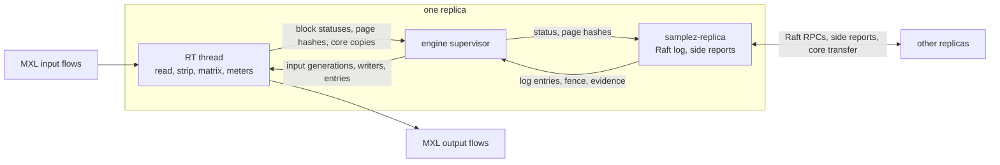

# samplez

A real-time multichannel audio engine on MXL flows, written in Rust, with
a replicated mode in which several engines compute the same output from
one replicated log.

samplez reads 48 kHz audio flows from MXL domains on libmxl's TAI
timeline, processes them in blocks of 16 to 1024 samples through a
channel strip per input and one gain matrix, and writes each output to
its own MXL flow at the sample index it read. Every change to what it
computes is an entry applied at a sample index. In replicated mode the
entries come from a Raft log that every replica of a set applies; each
replica hashes the pages it writes, the hashes are compared across the
set, and a replica whose output differs is marked diverged and resynced
from a donor's engine core.

samplez is a set of libraries and one example binary. The products
[faderz](https://github.com/danielclasen/faderz), an operated mixer, and
[foldz](https://github.com/danielclasen/foldz), a downmix and channel
matrix, are built on it.

- MXL audio input and output through libmxl v1.1.0, loaded at run time;
  up to 64 inputs, 64 outputs and 64 meters per engine
- Input selection by flow channel (`flowChannels`), re-routing to another
  flow with a crossfade, and fade-in and silencing of inputs at a sample
  index
- A channel strip per input, set by strip entries for inputs of up to 8
  channels: trim, per-leg trim and polarity, high-pass, four-band
  equaliser, gate and compressor
- A gain matrix with ramped coefficients; in replicated mode the engine
  entries of one log entry are folded and applied whole at its index
- Meters per output and meter: sample peak, RMS, true peak and EBU R 128
  loudness (momentary, short-term, integrated, loudness range); per
  input: sample peak, RMS and momentary loudness
- Duck groups: up to 8 detectors keyed by inputs after their strips,
  ducking the matrix coefficients their masks name by each input's
  depth, set by entries like every other target
- A real-time thread that does not allocate once its loop runs, checked
  by a test, RealtimeSanitizer and instruction-count limits; it runs
  `SCHED_FIFO` with locked memory, and degraded with a report when the
  privileges are missing
- Replicated mode: a Raft log over openraft, per-block commit statuses,
  XXH3-64 page hashes compared across replicas, resync of a diverged
  replica from a donor's engine core, clock verification of every
  replica against the set, and a compatibility key that a rollout hands
  the baseline over by
- A service layer for products: API, machine, ops and NMOS listeners,
  TLS, the auth modes `none`, `token`, `proxy` and `oidc`, `/healthz`,
  `/readyz`, Prometheus `/metrics` and WebSocket fan-out



Without replication (`Engine::start`, which `samplez-hop` uses) there is
no `samplez-replica`: the engine stamps its own entries.

samplez builds for x86_64 Linux only.

## Quick start

`samplez-hop` runs the engine from a JSON file with a static matrix. This
builds the builder image as CI does, builds `samplez-hop` in it and runs
it against an MXL domain in `/dev/shm`, mixing a stereo input flow to one
mono output flow.

```sh
docker build -t samplez-builder docker/builder
docker run --rm --user "$(id -u):$(id -g)" -v "$PWD:/w" -w /w \
  samplez-builder cargo build --locked --release --bin samplez-hop
mkdir -p /dev/shm/mxl/a
cat > hop.json <<'JSON'
{
  "libmxl": "/opt/mxl/lib/libmxl.so",
  "domains": [{ "name": "a", "path": "/mxl/a" }],
  "inputs": [{ "name": "in", "domain": "a",
               "flowId": "5fbec3b1-1b0f-417d-9059-8b94a47197ed", "channels": 2 }],
  "outputs": [{ "name": "out", "domain": "a",
                "flowId": "6fbec3b1-1b0f-417d-9059-8b94a47197ed",
                "label": "hop out", "group": "hop", "role": "Audio", "channels": 1 }],
  "matrix": [[0.5], [0.5]]
}
JSON
docker run --rm --name samplez-hop --user "$(id -u):$(id -g)" \
  --ulimit rtprio=99 --ulimit memlock=-1 \
  -v "$PWD:/w" -v /dev/shm/mxl/a:/mxl/a -w /w \
  samplez-builder target/release/samplez-hop --config hop.json
```

In another shell:

```sh
docker run --rm -v /dev/shm/mxl/a:/mxl/a samplez-builder mxl-info -d /mxl/a -l
```

The output flow `6fbec3b1-...` exists from the start; until a producer
writes the input flow, `samplez-hop` logs that the input is not attached
and the output carries silence. It logs each real-time set-up step at
start (`samplez-hop: rt ...`); the `--ulimit` flags let the RT thread run
`SCHED_FIFO` with locked memory. `docker stop samplez-hop` stops it, and
it deletes its output flow on the way out.

## Crates

| Crate | |
|---|---|
| `samplez` | the engine: configuration, supervisor, RT loop, block statuses and hold rings, state transfer, and `samplez-hop` |
| `samplez-dsp` | planar buffers, gain ramps, the mixing matrix with duck masks and depths, the channel strip, the duck detector, meters, true peak and loudness, history rings |
| `samplez-mxl` | MXL flow input and output on libmxl v1.1.0, loaded with `mxl::load_api` |
| `samplez-nmos` | NMOS for products: the IS-04 v1.3 Node API and the IS-05 v1.2 Connection API with MXL senders and receivers per BCP-007-03, BCP-004-01 receiver caps and BCP-002-01/02 tags |
| `samplez-replica` | a product's state replicated over openraft: the log and snapshots on the replica's volume, the applied command ids, the bridge to a replicated engine, clock checks, resync and rollouts |
| `samplez-service` | the non-RT service layer of products: listeners, TLS, auth, ops endpoints, the OpenAPI document and WebSocket fan-out |

## samplez-hop

`samplez-hop --config <file>` runs the engine from a JSON configuration:
N MXL input flows through a static gain matrix (one row per input
channel, one column per output channel and then per meter channel) to M
MXL output flows, on
libmxl's TAI timeline at 48 kHz. It stops on SIGINT or SIGTERM and
releases its writers, which deletes the output flows.

```json
{
  "blockSize": 48,
  "readerMarginSamples": 576,
  "libmxl": "/opt/mxl/lib/libmxl.so",
  "domains": [{ "name": "a", "path": "/run/mxl/a" }],
  "inputs": [{ "name": "in", "domain": "a",
               "flowId": "5fbec3b1-1b0f-417d-9059-8b94a47197ed", "channels": 2 }],
  "outputs": [{ "name": "out", "domain": "a",
                "flowId": "6fbec3b1-1b0f-417d-9059-8b94a47197ed",
                "label": "hop out", "group": "hop", "role": "Audio", "channels": 1 }],
  "matrix": [[0.5], [0.5]],
  "rt": { "enabled": true, "priority": 70, "rtCpu": "auto" }
}
```

Further keys and their defaults: `maxCatchupBlocks` 2, `pruneAfterBlocks`
50, `rampSamples` 480, `holdMs` 10, `contactWindowMs` 8, `duckColumns`
none (below),
`historySlackMs` 50, `resyncBudgetMs` 50, per input
`offsetSamples` 0 and `flowChannels` (below), per input and output `loudnessChannels` (one of `L`,
`R`, `C`, `Ls`, `Rs`, `LFE` per channel, weighted per ITU-R BS.1770-5
Table 3; without it every channel weighs 1), and `meters`, each with a
`name`, `channels` and `loudnessChannels`: matrix columns after the
outputs' that are computed and metered and written to no flow.

`sampleRate` takes 48000 only, `blockSize` 16 to 1024, `holdMs`,
`contactWindowMs` and `resyncBudgetMs` 1 to 1000, `historySlackMs` at
most 1000 and at least two blocks, `rampSamples` at most
`samplez_dsp::MAX_EXACT_RAMP_LEN` (2^23), every matrix gain finite and
within `samplez_dsp::MAX_GAIN` (1e6), `rt.priority` 1 to 99 and
`rt.rtCpu` `auto`, `none`, `first`, `last` or an index into the allowed
CPUs. Unknown keys are refused. Output flow ids are unique,
and no input reads a flow an output writes in the same domain.

An input's `channels` are its legs: its matrix rows, meter and strip.
Without `flowChannels` the input reads a flow of exactly that many
channels, in order. `flowChannels` names the 0-based flow channel each
leg reads, in leg order, as many as `channels`, each below 64; an index
may repeat, so `[0, 0]` feeds one channel to both legs of a stereo
input. The input then reads any flow with more channels than the
highest index, the flow it is configured with and every flow a `Route`
moves it to, and copies only the selected channels: one copy per leg,
however wide the flow. Legs 7 and 8 of a 16-channel flow:

```json
{ "name": "in", "domain": "a", "flowId": "5fbec3b1-1b0f-417d-9059-8b94a47197ed",
  "channels": 2, "flowChannels": [6, 7] }
```

The binary is `src/bin/samplez-hop.rs`, built with the library. A
usage or configuration error exits with status 2, an engine that fails
to start with status 1.

## Engine

### Meters

Each output's and each meter's status carries its meters: sample peak,
RMS and true peak per channel over the last 100 ms, the largest true
peak, the largest momentary and the largest short-term loudness since
the measurement started, and momentary, short-term and integrated loudness and loudness
range per EBU R 128. Each input's status carries the sample peak and
RMS per channel and the momentary loudness of the input after its
strip, read or silenced; it has no true peak.
RMS is referenced to a sine as in AES17: the root mean square times the
square root of 2, so a full-scale sine reads 1.0 (0 dB FS).
`Engine::reset_loudness` restarts the measurement of an output or a
meter at a sample index. A
meter record lost on the way from the RT thread, samples not metered
after an overrun, or an infinite or NaN sample mark integrated loudness
and loudness range invalid until the next reset.
After samples that were not metered, the true peak counts only
interpolated values computed from samples after them.

### Log entries

Every change to what the engine computes is a log entry applied at a
sample index: a gain change, `InputDown` (the input is silent from the
index on, whatever is readable), `InputUp` (it fades in from the index),
`Route` (it crossfades to another flow over the ramp length from the
index), `Detach` (it crossfades to silence over the ramp length from the
index and reads no flow, is not polled and is not reported until a
`Route` fades it in from silence; its up or down state is kept),
`Output` (an output disabled: nothing is written to it from the index
on and its writer is released, which deletes its flow unless another
writer holds it; or enabled: its flow is created as at start-up and
written from the first block due once the writer is in, another writer
live on the flow reported in the output's status and the creation
retried) and `Strip` (one parameter of an input's channel strip, a
`samplez_dsp::StripParam`, ramping over the ramp length). Each sets an
absolute target, so an entry applied again once its ramp has ended
changes nothing; applied again while it ramps, it starts the ramp over
from where it is. `InputUp`, `Route` and `Detach` need a new input
generation:
the engine builds it when the entry is appended, one at a time, and
swaps it in at the entry's index. The status reports the 99.99th
percentile of the build times and buildLead, how far ahead such entries
are stamped; `Engine::progress` reports buildLead and the build time,
the percentile and a supervisor tick without the engine's lead.
`Engine::start` keeps the log itself, stamping `InputDown`
when an input is pruned and `InputUp` once its head has advanced for a
second, wherever it stands against the clock, each `InputUp`,
`Route` (`Engine::route`) or `Detach` (`Engine::detach`) at least
buildLead after the one before, and an `Output`
(`Engine::set_output_enabled`) as a gain change;
`Engine::start_replicated` takes entries through `append`, `commit` and
`truncate` and sends those reports out instead.

A replicated log entry may carry any number of engine entries
(`append_batch`). They are folded off the RT thread: per matrix
coefficient, strip parameter and output the last value; per input slot
whether it is re-routed or detached, the last `Route` or `Detach`
counting, goes down and comes up, an `InputUp` after an `InputDown`
fading in from silence and a route kept whatever the state. The log
entry's batch is bounded by the engine's shape, shared by reference
and never changed once folded. It takes one of the 64
places the RT thread holds for log entries before their index, the
number the leader stamps ahead, and applies whole at its index, its
gains first; one generation covers every slot it raises or re-routes,
and a late one counts once in `command_late`. A log entry raising or
re-routing inputs of more than one domain, or with an entry refused
alone, is refused whole (`append_batch`, `admits`); `samplez-replica`
leaves out of a derived record what the engine refuses before it
appends it, so no committed entry is refused. One of no entries appends
nothing. A replicated engine refuses no committed entry for
room: up to 256 committed entries (`engine::WAITING`) wait in its log
for room in its entry ring; past that it drops them and its core
(`log_overflows`), and the replica is rebuilt or resynced. The RT thread
hands its spent batches to the supervisor to be freed, leaving the
return ring room for the generations and writers it hands back; one it
cannot hand off is leaked and counted in the status (`batches_leaked`).
A matrix may have at most 150 coefficients per sample of the block
(`COEFFICIENTS_PER_BLOCK_SAMPLE`), so that a batch setting all of them
applies within a quarter of the block period: 7,200 at a `blockSize` of
48, 153,600 at the largest, 1024. A larger matrix takes a larger
`blockSize`; a configuration beyond the limit is refused, naming the
`blockSize` its matrix needs.

### Channel strip

Each input of 1 to 8 channels has a strip: trim, per-leg trim and
polarity, high-pass, a four-band equaliser, gate and compressor
(`samplez_dsp::strip`). It runs on every block computed, after the
input's copy, fade-in or crossfade and before the matrix, and passes
its input unchanged until an entry sets it. Its ramps advance over
skipped samples, as the matrix's do; its filter and envelope state
follows the samples it processed, so after a skip or a silenced read it
differs from that of an engine that computed them, until a resync
copies a donor's. A filter state above 1e30 or not finite, which only a
non-finite or overflowing input leaves, is set to zero after each
block, so the strip recovers at the next one. An entry for
an input wider than 8 channels, or one its strip refuses, is refused
when appended (`append`) or set (`set_strip`); one that a strip on the
RT thread still refuses is counted in `strip_refused`, not applied, and
marks the engine diverged.

### Duck groups

An engine has 8 duck groups (`samplez_dsp::MAX_DUCKS`), each a detector
(`samplez_dsp::duck`) whose envelope, between 0 and 1, ducks every
matrix coefficient whose duck mask names the group by its input
channel's depth under the group times the envelope, in dB; of several
groups on one coefficient the deepest counts. `Entry::Duck` sets one
setting of a group (`DuckSetting`): the detector's parameters, its keys
(up to 8 input slots after their strips, each at a linear gain), its
mode (`Auto`, `On`, `Off`), its momentary hold, and the depth of an input
slot's rows, 0 to 40 dB. `Entry::DuckMask` sets the mask of one
coefficient, bit `g` for group `g`; a mask other than 0 is taken only on
a column `duckColumns` names. Each sets an absolute target from the
entry's index: a depth ramps and a mask crossfades from the old mask's
gain to the new one's over the ramp length, a parameter or mode change
moves only the detector's decision, so no change steps. A key whose slot
changes, or that is newly keyed, starts with its filters at rest.
`Engine::set_duck` and `Engine::set_duck_mask` set them on an engine
keeping its own log; a replicated log takes them in `append_batch`,
folded per group and kind of setting, per depth and per mask, and
`admits` refuses what a group cannot hold: a ninth key, a slot keyed
twice, beyond the inputs or wider than 8 channels, a value out of range.

The detectors run on every block computed, after the strips, on the grid
of the sample index, and the matrix is aligned to the index before it
mixes, so the output depends on neither the block size nor where a core
was copied. A group with no key, not on and at rest is advanced rather
than run, which computes the same envelope, 0. A coefficient of a column
in `duckColumns` counts 6 times against the 150 coefficients per sample
of the block (`DUCKED_TERM_COST`): a ducked term mixes at 5.5 times the
instructions of a plain one on the AVX2 path. Each group's readings over
each meter slice of 10 ms it is in use in, its largest key, its largest
envelope and whether it was engaged, are in the status (`Status::ducks`);
they stay with the replica.

### Clock

The engine runs on libmxl's clock (CLOCK_TAI) and detects a step of it
against CLOCK_MONOTONIC at each wake, when it also samples the kernel
TAI offset (CLOCK_TAI - CLOCK_REALTIME); the status reports both, and
whether `adjtimex` finds the kernel clock unsynchronised. A block index
is never computed twice: after a backward step the loop wakes once per
block period without computing until the clock is due at the block
after the last one again. In replicated mode a detected step fences the
blocks after it until the replicated state clears it
(`clear_step_fence`), or with one voter until its next clean
self-report; a backward step also withholds every block held, and an
unsynchronised kernel clock leaves blocks without a digest.

### Real-time set-up

Real-time set-up reports each step and runs degraded rather than failing:
effective capabilities raised from the permitted set, `mlockall` with
`MCL_FUTURE` only under `CAP_IPC_LOCK` or an unlimited `RLIMIT_MEMLOCK`,
SCHED_FIFO for the RT thread, FTZ/DAZ and blocked signals on it.
`rtCpu: auto` pins the RT thread to the last allowed CPU only when
`SAMPLEZ_CPU_REQUEST_MILLICORES` and `SAMPLEZ_CPU_LIMIT_MILLICORES` are
equal whole CPUs matching the allowed set and the cgroup CPU quota is
unlimited or the same size.

## Replicated mode

### Commit and withdrawal

`Engine::start_replicated` takes the set's voter count. With one voter
the engine commits every block at once. With more, each block of each
output gets a status word (`fenced`, `held`, `committed`, `withheld`),
moved by compare-and-swap and sent as `StatusChange`s; the replicated
state publishes F (`set_fence`), the ranks (`set_ranks`: one up to a
block, another from it on, and the rank of a withdrawn replica's fills),
and evidence (`commit_through`, for the whole block or up to a sample
index inside it), and withholds blocks (`withhold`). An output commits
only from its commit start (`commit_from`, dropped again before it takes
by `cancel_commit_start`), the first page boundary of
1024 samples in a block it computes, and stops at `stop_at`; such a block
is split and its status covers one range. `standing` reads whether an
output commits, from which sample, or since which block it does not. A healthy block with F past it and nothing held before
it commits at once; any other waits in the output's hold ring of
`D + w + 2B` samples (`holdMs`, default 10, and `contactWindowMs`, default
8) and is committed later in one write, or withheld and never written. A
withheld block, an overrun skip or a full ring withdraws the replica on
every output: it then commits only on evidence, from the next page
boundary. Each block carries a digest of what degraded it: inputs whose
read failed, entries applied without their generation and unresolved
entries (`unresolved`). A writer commits a range of up to the ring's
length, and an output whose flow ring is not twice that is not
realised. Each page of each realised output the engine computes whole,
in every commit mode, is hashed (XXH3-64 over its samples' f32 bit
patterns, channels interleaved per index) and sent as a `PageHash`
once every block overlapping it is final, with the fingerprint of the
log entries applied in it and whether the page was committed whole.

### Resync

For a resync, `Engine::copy_core` has the RT thread copy the engine's
core after the next block k0 into a buffer allocated off it: the matrix
with its ramps, duck masks, depths and mask crossfades, the duck
detectors with their keys, filter, hold and envelope state, the pending
entries and those applied in the page in progress, each input's log
state and fades, each strip with its filter and dynamics state and
position, the entries waiting for a generation and the pending
generation's entry id, and the unresolved entries.
Meters, hold rings, statuses and readers stay with the replica.
History rings (`History` in samplez-dsp) hold a delay plus
`historySlackMs` of slack as relaxed atomic bit patterns; the RT thread
publishes the block it starts before it stores any history sample, and a
copy is kept only while the RT thread has not started the last block of
the slack after k0. The engine keeps no delay line yet, so a copy holds
the core alone. With more than one voter every input flow must offer
`resyncBudgetMs` of history beyond the read window; an input whose flow
is shorter is refused with an error naming the `history_duration` it
needs. A lone voter has no donor to resync from and needs none.

`Engine::replay` builds a replay clone from a donor's core: the engine's
block computation off the RT thread, its readers on a new instance per
input domain reading the blocks after k0 from the flows' history, its
entries and unresolved-entry decisions after the core's last log id
taken from the caller, and every page it computes whole hashed. A core
with a generation-needing entry in flight (`InputUp`, `Route`, `Detach`,
a pending generation or a crossfade) is not replayed, nor one whose
detached inputs are not the engine's. `Replay::run_to` stops at the
newest block due, and `Replay::silenced` names the blocks computed with
an input silenced. `Engine::hand_over` waits for the RT thread to
compute a block, runs the clone up to it and passes its state to the RT
thread by owned pointer before the next wake, about one block period
later; the RT thread installs it
before the next block if it has not started that block, still holds the
generation the core names and took no entry off its pending list that
the core does not know, keeping pending entries the core did not know,
and computes on from it. A state refused for a passed block or a
generation is tried again; one missing an entry returns
`ReplayError::Missed`. Refusals are counted per cause.
The status reports the replay speed s, blocks per block period, measured
at start-up on silence.

`CoreCopy::encode` gives a copy as another replica takes it, JSON with
the engine version; `CoreCopy::decode` refuses a core of another version
or one holding a value no engine holds (an index beyond 2^62, a gain or
strip parameter out of range, a ramp past its length, a matrix beyond
`MAX_COEFFICIENTS`, 2^18, which configurations are held to as well, a
strip `Strip::is_valid` refuses: a parameter, gain, envelope, pole,
ramp or state beyond any a strip reaches, a filter target other than
its parameters' or a filter ramp outside the box of every target, a
detector `Detector::is_valid` refuses, a duck key without its slot or a
slot without its key, a mask, depth or mask crossfade out of range, or a
duck setting no group takes), and `Engine::replay` one of another shape,
with strips or duck keys of other legs or ramp length, or with an entry
outside the engine.

### Starting a replica

`Engine::drop_core` drops the RT thread's core while the replica starts:
the RT thread keeps its writers, flows, hold rings and statuses, computes
no block and withholds each one, overrun skips included, cause `NoCore`
(`StatusChange::NoCore` ranges), with the replica withdrawn. Entries
needing no generation whose index passes meanwhile are taken off the
pending list, strip entries applied to the strips the slots keep and the
others, duck entries included, not, and the core installed next must
know them; a batch holding
an `InputUp` or `Route` stays pending whole. A replayed core
replaces the strips; one built from product state leaves them.
`Engine::install_product` builds a core from product state off the RT
thread (fades cold, the pending entries, no unresolved entry; the RT
thread keeps its pending generation) and installs it through the same
block-boundary hand-over as a replay, at the first block starting at or
after the index its caller names; the first block committed after it
follows the withdrawn rules. A state holding a gain, flow, strip
parameter or duck value no entry could set is refused before anything
changes. Its
gains ramp from silence to their
targets over the ramp length from the install, as the strips take their
parameters, so an output fades in processed. Its duck groups start cold
at the state's settings: key filters at rest, no hold, the envelope at 0
or, for a group its mode On or hold triggers, at full depth; masks and
depths at their targets, so a coefficient fades in ducked. A replica
that kept computing holds its own key filter, hold and envelope state,
so their outputs differ after the install until the gains' ramp has run,
each key filter's state has reached the same bits and each group's
envelope has reached 0 or full depth in both; on a test desk with an
Auto group mid-duck, a group releasing after its force ended and a key
filter ringing they are equal from the ramp, 50 ms and the longest
attack, hold and release of a group on. The product state also
names each slot's flow and strip parameters: the supervisor hands over
generations reading those flows before the core, a slot on another flow
moving to it with no crossfade, and the strip parameters are set from
the install's index, each strip keeping its own state. `Targets` holds
every gain, flow, strip parameter, duck group setting and duck mask as
values; `Targets::diff` gives the entries that move an engine from one
set of targets to another, comparing every value by bit pattern, and
`Targets::assert` the entries that set all of them.

In `samplez-replica` every audio replica starts clock-unverified, which
drops its engine's core until it verifies, and a snapshot install, a
purge-point verdict, a log overflow or a lag beyond the horizon drops it
again. The core is rebuilt from the applied state
(`StateMachine::product_state`): the product's targets, each slot up as
its latest `InputDown` or `InputUp` says and up where none is, no
pending entry and the applied log index as its last id, installed at the
first block at or after the floor of the applied log. Every record of an
entry up to that index takes effect at or before the floor and every
later one at or after it, so the records handed after the rebuild apply
on top of it in order; an install the RT thread can no longer take is
tried again with a fresh read. Under continuous writes the floor lies up
to `maxApplyLead` and a generation's build ahead, and the rebuild waits
that long. `EngineAudio` installs the state as the records it filters
leave an engine (below): a flow other than the one an input reads is a
re-route kept by the same rules and else left as read, a strip parameter
the engine refuses is not set, a gain it refuses is silent, a duck
setting it refuses is left at what no entry sets and a mask it refuses
is 0. A
product without targets gives an empty
state, which an engine refuses: its replicas stay in `starting`.

A product that drives an engine (`Product::DRIVES_ENGINE`) gives its
absolute engine targets (`Product::targets`), and the state machine
derives each log entry's engine entries as it applies, from the state
after it: the diff of the targets for a command or a lease expiry that
changed the product, every target and the routes of the entry it names
for a restamp of one that derived some, an input's state for an
`InputDown` or `InputUp`. Each record applies at the entry's index
raised to the floor, the highest index of any entry before it, so the
engine applies them in log order and each diff applies to the targets it
was computed against; an index further than one second past the entry's
stamp counts as the stamp, and a lease expiry from an older leader, which
stamps none, takes effect 2400 samples (50 ms) past its stamp.
`EngineAudio` hands an index off a block start at the next one. An `InputDown` or `InputUp` derives its
input's state for any product, since the engine's input health writes
them. A restamp, or a void the leader stamped, of an entry that derived
records re-asserts every target at its own index, so it undoes no later
entry; one of an engine body moves or drops it. Records are kept in
memory for a second past their index; the floor and which decidable
entries derived records, with the inputs they re-routed, are in
snapshots.

Contact hands an entry's record to the engine as the entry applies on
the replica, and the record's index is the one contact lists and awaits
the entry at from its append on, the floor being a function of the log
prefix. An entry not applied by its apply deadline is unresolved and its
record never handed, however early reports made its commit known; the
log decides it. The leader stamps entries the lead ahead, which it keeps
on the slack every counted audio replica reports at its apply-hand, up
to `maxApplyLead`; a replica that still applies past the deadline at the
cap holds those entries unresolved alone, and the leader's contact
metrics name it (`apply_lead_raised_by`). One AppendEntries carries up to
`MAX_APPEND_BYTES` of commands, so a follower whose fsync takes longer
than the gap between entries takes every entry written meanwhile with
one fsync rather than falling further behind. `EngineAudio` leaves out
of a record the entries its engine refuses, and of the `InputUp`s and
`Route`s of several input domains those not of the lowest slot's,
before it appends it: the
engine's configuration decides that alike on every replica of a key, so
the outputs still agree, and it is counted in `entries_filtered` and
logged as the product's fault. A resync's joiner replays the records of
the entries applied after the donor core's last log id; one it no longer
holds, past the second kept or before a snapshot it loaded, fails the
attempt, which is retried on a newer core. A client command that would
re-route an input (`Product::reroutes`) is ordered alone on the
generation path, stamped the lead and the longest build time a counted
replica reports past its stamp, since its generation is built once it
applies; one asking for an index beyond the earliest is refused. Such a product owns every input's flow: `Replica::append`
refuses a `Route` or `MasterEnable` for it.

A replica's store builds its empty product with the `Factory` it is
given, at open and for every snapshot it installs, so the product keeps
the replica's configuration. Product state is shared by every replica,
so every member, learners and the witness included, needs equal
configuration as far as it changes how a command applies or a saved
state loads (`Product::config_hash`). The checks detect a difference;
they do not undo it. Reports carry the hash: the leader orders no
client command while a voter or a learner reports another one
(`unavailable`, naming it), until that member reports the set's hash or
leaves the membership, and promotes no learner of another hash. A
report without a hash, from a replica that records none, names none. A
snapshot carries its sender's hash: a replica of another hash refuses
it before anything is written and exits with status 78, so it restarts
visibly; restarted under the set's configuration it installs the
snapshot; an embedder chooses otherwise with
`Store::on_config_mismatch`. The replica whose hash differs from the
others' is the one to fix, and it may be the sender: a lagging replica
of the set's configuration exits on a snapshot from one that is not.
Each replica's hash is in its contact metrics (`config_hash`). A store
warns at open when its snapshot was built under another hash: expected
once after a change made with every replica stopped; otherwise the
replica ran under another configuration than the set's, holds another
state and is rebuilt from an empty volume. A configuration change of that kind is made with every
replica stopped.

A replica set agrees on its cluster id through the marker ConfigMap that
ordinal 0 creates on an empty volume (`bootstrap::Kube`). Given the audio
StatefulSet's name, the one `rollout::follow` reads, with
`Kube::owned_by`, the marker carries an owner reference to that
StatefulSet, and the garbage collector deletes it after the StatefulSet,
in the background; `--cascade=orphan` keeps it. Reading the
StatefulSet's uid takes the same `get` on `statefulsets` the rollout's
target revision does. Without a name the marker has no owner. The leader
of a running set recreates a missing marker under the set's cluster id,
so a StatefulSet created again on kept volumes goes on as the same set;
an owned marker is created only for the StatefulSet the process first
read, and not while it is being deleted.
With no set running, an empty volume waits for a marker; one created by
hand with `data.cluster` from a member volume's `cluster` file and
`data.volume` 0 lets it join.

## Real-time requirements

The RT thread does not allocate once its loop runs (`tests/no_alloc.rs`
checks it). The loop also passes RealtimeSanitizer (`tests/rtsan.rs`,
built with `-Zsanitizer=realtime --cfg samplez_rtsan` on the nightly),
which aborts on allocations, pthread locks, blocking syscalls and the
sleeps its runtime intercepts. Allowed by call site are the calls that
block by design: libmxl's sync-group wait, `mxlSleepUntil` and the
`FUTEX_WAKE` of the output commit. RealtimeSanitizer does not see an
uncontended std lock, which makes no libc call, nor
`std::thread::sleep`, which calls `clock_nanosleep`; clippy denies those
and the other blocking std primitives listed in `clippy.toml` in the RT
modules. `cargo bench --bench rt` in samplez, samplez-dsp and
samplez-mxl fails when the instruction count of the hold ring's paths,
the page hashes, the strip calls of the RT loop, a block's DSP, duck
detectors and input meters, the matrix and detector copies of the core,
a duck batch, a block's history stores or an output commit,
gap zero-fill included, exceeds the limit in the benchmark. One failure
path is
excepted from the no-allocation rule, and its probe is allowed by call
site under RealtimeSanitizer: while an input is late, libmxl's flow
validity check, one `stat()` and path allocations, can run on the RT
thread. It ends when the input is pruned, after `pruneAfterBlocks`
blocks of a frozen head, or twice the producer's
`maxCommitBatchSizeHint` plus `readerMarginSamples` when that is longer.

The host needs swap off and `vm.compact_unevictable_allowed=0`, so that
neither swapping nor compaction moves the locked pages of the RT
thread. MXL domains belong on tmpfs: on a disk-backed file system a
commit into an output's shared mapping can wait for the page's
writeback, and the loop then skips blocks.


## NMOS

`samplez-nmos` gives a product an NMOS node for its MXL writers and
readers per AMWA BCP-007-03: one Source, Flow and Sender per writer and
one Receiver per reader, transport `urn:x-nmos:transport:mxl`. The
product describes them in a `NodeModel`, implements `Connections`
(what a domain holds under a flow id, and applying an activation) and
`Store` (the last `/active` per port, read at start), serves
`Nmos::router()` on its NMOS listener (`Service::nmos`) and runs
`Nmos::registration()`. The crate links no libmxl and runs on the
product's non-RT runtime.

- IS-04 v1.3 (Node API and registration) and IS-05 v1.2 (single and
  bulk) only.
- `/active` is written when an activation fires. Each port hands its
  activations to `Connections::apply` one at a time and in order: an
  immediate one once `/active` shows it, a scheduled one
  `Connections::lead` before its time. A cancel after that hands the
  product the still-active connection for the same time. A failed apply
  sets `master_enable` false in `/active` with a new IS-04 version.
- Scheduled activations are held in memory: a restart drops them.
- No IS-10 or BCP-003-01: the APIs answer without authentication, and
  the registration client sends no credentials and uses registries
  advertising `api_proto=http` and `api_auth=false` only, so no TLS.
- No peer-to-peer mode: without a registry the node is not advertised.
- `PUT /receivers/{id}/target` answers 501.

CI runs the AMWA nmos-testing suites IS-04-01 (unicast and multicast
DNS-SD), IS-05-01 and BCP-007-03-01 against the example node
(`cargo run -p samplez-nmos --example nmos-node`), restarting it between
suites and failing when a resource id changes across a restart. The tool
validates against the AMWA specification commits pinned in
`tests/nmos/specs.txt`, not against their latest state. Results other
than Pass are accepted only as listed, with their reason from the
tool's source, in `tests/nmos/expected.json`, and each suite has to run
at least the number of tests listed there. Of the Manual tests,
IS-04-01 test_22 (ids persist over a restart) is the restart check;
BCP-007-03-01 test_15 (MXL reads and writes start and stop on
activation) needs a product with an engine and is not covered here.

## Building and testing

`docker/builder` holds the build environment: Rust 1.96.0, clang and
libclang for bindgen, a Release build of libmxl (MXL v1.1.0) installed
under `/opt/mxl` with its tools `mxl-info` and `mxl-data-probe`, and the
tools of the RT gates: a pinned nightly with `rust-src`
(`$SAMPLEZ_NIGHTLY`), Valgrind and the Gungraun runner. CI builds it and
builds and tests inside it; `.github/workflows/builder.yml` publishes it
from `main` as `ghcr.io/danielclasen/samplez-builder`.

```sh
docker build -t samplez-builder docker/builder
docker run --rm --user "$(id -u):$(id -g)" -v "$PWD:/w" -w /w \
  samplez-builder cargo test --workspace --locked
```

The end-to-end scenarios run `samplez-hop` against libmxl flows and need
`SCHED_FIFO` and locked memory to hold their timing, so `cargo test
--workspace` leaves them out; CI runs them over the debug and the release
build with the limits raised:

```sh
docker run --rm --user "$(id -u):$(id -g)" --ulimit rtprio=99 --ulimit memlock=-1 \
  -e SAMPLEZ_REQUIRE_RT=1 -v "$PWD:/w" -w /w \
  samplez-builder cargo test --locked --test hop
```

The RT gates, RealtimeSanitizer on the nightly and the instruction-count
benchmarks:

```sh
docker run --rm --user "$(id -u):$(id -g)" -v "$PWD:/w" -w /w \
  samplez-builder bash -c '
    RUSTFLAGS="-Zsanitizer=realtime --cfg samplez_rtsan" \
      cargo "+$SAMPLEZ_NIGHTLY" test --locked -Zbuild-std \
      --target x86_64-unknown-linux-gnu --lib --test rtsan
    cargo bench --locked -p samplez -p samplez-dsp -p samplez-mxl --bench rt'
```

The NMOS schema test validates every document `samplez-nmos` serves
against the AMWA schemas at the commits pinned in
`crates/samplez-nmos/tests/specs.txt`, so it needs them checked out
first; `cargo test --workspace` leaves it out:

```sh
crates/samplez-nmos/tests/fetch-specs.sh
docker run --rm --user "$(id -u):$(id -g)" -v "$PWD:/w" -w /w \
  samplez-builder cargo test --locked -p samplez-nmos --test schemas
```

CI also sets `SAMPLEZ_REQUIRE_PATHS=avx2`, so a matrix test fails rather
than skips the AVX2 path on a CPU without it, lints with `cargo fmt --all --check` and `cargo
clippy --workspace --all-targets --locked -- -D warnings`, checks every
dependency's licence against `deny.toml` with `cargo deny check licenses`,
fails a crates.io release that `Cargo.lock` gains under 14 days old unless
`.github/lockfile-age/allow.txt` lists it,
and runs the
kernel clock tests of `samplez-replica` (`--test vm_clock`, a TAI offset
step and a leap second) in a VM, since they step the clock.

## Licence

Apache-2.0. The builder image carries the licence files of MXL and of the
libraries statically linked into libmxl under `/opt/mxl/share/licenses`.
