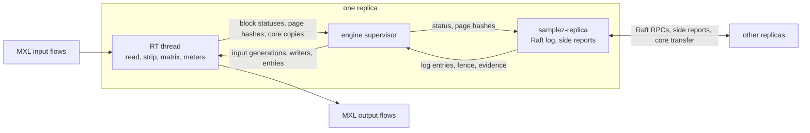

# samplez

A real-time multichannel audio engine on MXL flows, written in Rust, with
a replicated mode in which several engines compute the same output from
one replicated log.

samplez reads 48 kHz audio flows from MXL domains on libmxl's TAI
timeline, processes them in blocks of 16 to 1024 samples through a
channel strip per input and one gain matrix, and writes each output to
its own MXL flow at the sample index it read. Every change to what it
computes is an entry applied at a sample index. In replicated mode the
entries come from a Raft log that every replica of a set applies; each
replica hashes the pages it writes, the hashes are compared across the
set, and a replica whose output differs is marked diverged and resynced
from a donor's engine core.

samplez is a set of libraries and one example binary. The products
[faderz](https://github.com/danielclasen/faderz), an operated mixer, and
[foldz](https://github.com/danielclasen/foldz), a downmix and channel
matrix, are built on it.

- MXL audio input and output through libmxl v1.1.0, loaded at run time;
  up to 64 inputs, 64 outputs and 64 meters per engine
- Input selection by flow channel (`flowChannels`), re-routing to another
  flow with a crossfade, and fade-in and silencing of inputs at a sample
  index
- A channel strip per input, set by strip entries for inputs of up to 8
  channels: trim, per-leg trim and polarity, high-pass, four-band
  equaliser, gate and compressor
- A delay line per input, opt-in by configuration, up to 5 s
- Line-up tone generators: an input configured with `tone` reads no flow
  and computes a sine of 20 Hz to 20 kHz at -60 to 0 dBFS on its legs,
  with an ident that cuts the legs in turn, set by tone entries
- A gain matrix with ramped coefficients; in replicated mode the engine
  entries of one log entry are folded and applied whole at its index
- A true-peak limiter per output of up to 8 channels, configured per
  output and set by limiter entries
- Meters per output and meter: sample peak, RMS, true peak and EBU R 128
  loudness (momentary, short-term, integrated, loudness range); per
  input: sample peak, RMS and momentary loudness
- Duck groups: up to 8 detectors keyed by inputs after their strips,
  ducking the matrix coefficients their masks name by each input's
  depth, set by entries like every other target
- A real-time thread that does not allocate once its loop runs, checked
  by a test, RealtimeSanitizer and instruction-count limits; it runs
  `SCHED_FIFO` with locked memory, and degraded with a report when the
  privileges are missing
- Replicated mode: a Raft log over openraft, per-block commit statuses,
  XXH3-64 page hashes compared across replicas, resync of a diverged
  replica from a donor's engine core, clock verification of every
  replica against the set, and a compatibility key that a rollout hands
  the baseline over by
- A service layer for products: API, machine, ops and NMOS listeners,
  TLS, the auth modes `none`, `token`, `proxy` and `oidc`, `/healthz`,
  `/readyz`, Prometheus `/metrics` and WebSocket fan-out



Without replication (`Engine::start`, which `samplez-hop` uses) there is
no `samplez-replica`: the engine stamps its own entries.

samplez builds for x86_64 Linux only.

## Quick start

`samplez-hop` runs the engine from a JSON file with a static matrix. This
builds the builder image as CI does, builds `samplez-hop` in it and runs
it against an MXL domain in `/dev/shm`, mixing a stereo input flow to one
mono output flow.

```sh
docker build -t samplez-builder docker/builder
docker run --rm --user "$(id -u):$(id -g)" -v "$PWD:/w" -w /w \
  samplez-builder cargo build --locked --release --bin samplez-hop
mkdir -p /dev/shm/mxl/a
cat > hop.json <<'JSON'
{
  "libmxl": "/opt/mxl/lib/libmxl.so",
  "domains": [{ "name": "a", "path": "/mxl/a" }],
  "inputs": [{ "name": "in", "domain": "a",
               "flowId": "5fbec3b1-1b0f-417d-9059-8b94a47197ed", "channels": 2 }],
  "outputs": [{ "name": "out", "domain": "a",
                "flowId": "6fbec3b1-1b0f-417d-9059-8b94a47197ed",
                "label": "hop out", "group": "hop", "role": "Audio", "channels": 1 }],
  "matrix": [[0.5], [0.5]]
}
JSON
docker run --rm --name samplez-hop --user "$(id -u):$(id -g)" \
  --ulimit rtprio=99 --ulimit memlock=-1 \
  -v "$PWD:/w" -v /dev/shm/mxl/a:/mxl/a -w /w \
  samplez-builder target/release/samplez-hop --config hop.json
```

In another shell:

```sh
docker run --rm -v /dev/shm/mxl/a:/mxl/a samplez-builder mxl-info -d /mxl/a -l
```

The output flow `6fbec3b1-...` exists from the start; until a producer
writes the input flow, `samplez-hop` logs that the input is not attached
and the output carries silence. It logs each real-time set-up step at
start (`samplez-hop: rt ...`); the `--ulimit` flags let the RT thread run
`SCHED_FIFO` with locked memory. `docker stop samplez-hop` stops it, and
it deletes its output flow on the way out.

## Crates

| Crate | |
|---|---|
| `samplez` | the engine: configuration, supervisor, RT loop, block statuses and hold rings, state transfer, and `samplez-hop` |
| `samplez-dsp` | planar buffers, gain ramps, the mixing matrix with duck masks and depths, the channel strip, the output limiter, the duck detector, meters, true peak and loudness, history rings |
| `samplez-mxl` | MXL flow input and output on libmxl v1.1.0, loaded with `mxl::load_api` |
| `samplez-nmos` | NMOS for products: the IS-04 v1.3 Node API and the IS-05 v1.2 Connection API with MXL senders and receivers per BCP-007-03, BCP-004-01 receiver caps and BCP-002-01/02 tags |
| `samplez-replica` | a product's state replicated over openraft: the log and snapshots on the replica's volume, the applied command ids, the bridge to a replicated engine, clock checks, resync and rollouts |
| `samplez-service` | the non-RT service layer of products: listeners, TLS, auth, ops endpoints, the OpenAPI document and WebSocket fan-out |

## samplez-hop

`samplez-hop --config <file>` runs the engine from a JSON configuration:
N MXL input flows through a static gain matrix (one row per input
channel, one column per output channel and then per meter channel) to M
MXL output flows, on
libmxl's TAI timeline at 48 kHz. It stops on SIGINT or SIGTERM and
releases its writers, which deletes the output flows.

```json
{
  "blockSize": 48,
  "readerMarginSamples": 576,
  "libmxl": "/opt/mxl/lib/libmxl.so",
  "domains": [{ "name": "a", "path": "/run/mxl/a" }],
  "inputs": [{ "name": "in", "domain": "a",
               "flowId": "5fbec3b1-1b0f-417d-9059-8b94a47197ed", "channels": 2 }],
  "outputs": [{ "name": "out", "domain": "a",
                "flowId": "6fbec3b1-1b0f-417d-9059-8b94a47197ed",
                "label": "hop out", "group": "hop", "role": "Audio", "channels": 1 }],
  "matrix": [[0.5], [0.5]],
  "rt": { "enabled": true, "priority": 70, "rtCpu": "auto", "isolateRtCpu": true }
}
```

Further keys and their defaults: `maxCatchupBlocks` 2, `pruneAfterBlocks`
50, `rampSamples` 480, `holdMs` 10, `contactWindowMs` 8, `duckColumns`
none (below),
`historySlackMs` 50, `resyncBudgetMs` 50, per input
`offsetSamples` 0, `flowChannels` (below), `flowId` and `tone` (Tone
generator) none, per output
`enabled` true, per input and output `loudnessChannels` (one of `L`,
`R`, `C`, `Ls`, `Rs`, `LFE` per channel, weighted per ITU-R BS.1770-5
Table 3; without it every channel weighs 1), per input `maxDelaySamples`
0 and `truePeak` false (Meters), per output `limiter` false (below), per
output and meter `correlation` false (Meters), and `meters`, each with a
`name`, `channels` and `loudnessChannels`: matrix columns after the
outputs' that are computed and metered and written to no flow.

`sampleRate` takes 48000 only, `blockSize` 16 to 1024, `holdMs`,
`contactWindowMs` and `resyncBudgetMs` 1 to 1000, `historySlackMs` at
most 1000 and at least two blocks, `rampSamples` at most
`samplez_dsp::MAX_EXACT_RAMP_LEN` (2^23), every matrix gain finite and
within `samplez_dsp::MAX_GAIN` (1e6), `rt.priority` 1 to 99 and
`rt.rtCpu` `auto`, `none`, `first`, `last` or an index into the allowed
CPUs. Unknown keys are refused. Output flow ids are unique,
and no input reads a flow an output writes in the same domain. An input
has a `domain`, or is a tone generator, `tone: {}`, with no `domain`,
`flowId`, `flowChannels` or `offsetSamples`:

```json
{ "name": "lineup", "tone": {}, "channels": 2 }
```

An input without `flowId` starts as a `Detach` leaves it (below): it
opens no reader, is not polled and is not reported until a `Route`. An
output with `enabled` false starts as a disabled `Output` leaves it: no
flow is created for it until an `Output` entry enables it.

An input's `channels` are its legs: its matrix rows, meter and strip.
Without `flowChannels` the input reads a flow of exactly that many
channels, in order. `flowChannels` names the 0-based flow channel each
leg reads, in leg order, as many as `channels`, each below 64; an index
may repeat, so `[0, 0]` feeds one channel to both legs of a stereo
input. The input then reads any flow with more channels than the
highest index, the flow it is configured with and every flow a `Route`
moves it to, and copies only the selected channels: one copy per leg,
however wide the flow. Legs 7 and 8 of a 16-channel flow:

```json
{ "name": "in", "domain": "a", "flowId": "5fbec3b1-1b0f-417d-9059-8b94a47197ed",
  "channels": 2, "flowChannels": [6, 7] }
```

The binary is `src/bin/samplez-hop.rs`, built with the library. A
usage or configuration error exits with status 2, an engine that fails
to start with status 1.

## Engine

### Meters

Each output's and each meter's status carries its meters: sample peak,
RMS and true peak per channel over the last 100 ms, the largest true
peak, the largest momentary and the largest short-term loudness since
the measurement started, and momentary, short-term and integrated loudness and loudness
range per EBU R 128. Each input's status carries the sample peak and
RMS per channel and the momentary loudness of the input after its
strip, read or silenced; with `truePeak` set in the input's config,
also its true peak and largest true peak, computed as an output's at
the same cost per channel, and without it none.
RMS is referenced to a sine as in AES17: the root mean square times the
square root of 2, so a full-scale sine reads 1.0 (0 dB FS).

An output or meter with `correlation` set in its config, 2 channels or
more, also carries the correlation of its legs 0 and 1 (L and R of a
stereo or wider element; legs 2 on are not correlated) over the 400 ms
up to the end of the last 100 ms window: the sum of their products over
the root of the product of their sums of squares, from -1 to 1, over
the 10 ms slices of those windows whose records all arrived. It reads 0
with one leg silent, none with both, and none without `correlation`.
It costs one multiply-add per sample on the RT thread and one meter
record more per 10 ms slice. Like the peaks and RMS it is a reading of
the samples metered: gap and paused slices count in it, a slice metered
in part counts with the samples it has, and a reset of the loudness
measurement does not restart it. A product that hashes its configuration
into its compatibility key covers the setting there.

A meter's measurement is reset and paused by log entries, applied at
their index like every other entry, so every replica following the log
resets and pauses it at the same sample; the log decides, not a
replica's own timing. Meters are numbered as their statuses are: the
outputs, then the configured meters. A `ResetLoudness` entry restarts the
measurement (the integrated loudness, the loudness range, the maxima and
the counts below) at the first 100 ms window starting at or after its
index. A `LoudnessRun` entry pauses the measurement from its index, or
runs it again: every 10 ms slice with a sample metered while paused,
computed or skipped, is left out of the integrated loudness, the
loudness range and the maxima as a gap is, but counted in `paused`, not
in `gaps` or `lost`, and the momentary and short-term loudness keep
following the output through it. Once the measurement runs again, the
maxima take no momentary or short-term value reaching back into the
pause. Each meter's status reports `running`: whether the last slice
metered was not paused, so a slice the log paused or ran again within
reads paused. Every meter starts running. A standalone engine takes
both through `Engine::reset_loudness` and
`Engine::set_loudness_running`, which append the entries to its own
log; a replicated engine takes them from the log only.

Integrated loudness and loudness range leave out every 10 ms slice that
is a gap, lost or paused, and carry on over the rest: their gating
blocks and
short-term values are taken over the kept slices one after the other,
as if the slices left out had not been there. This is a deliberate
deviation from a strict reading of EBU Tech 3341 and 3342, which measure
a programme without interruption: an input taken down or a slice lost
neither blanks the measurement nor lowers it with the silence or the
partial mix it leaves. Momentary and short-term loudness restart after
a gap, a lost slice or a paused slice without a power (cut by lost
records or skipped), not after a paused slice metered whole. Each
output's and meter's status counts gaps and lost slices since the
measurement started:

- `gaps`: slices in which an input down by the log (an `InputDown`
  applied; a `Detach` is not one) fed one of the meter's columns through
  a coefficient whose target, the value the last gain change set, is
  other than 0, and slices whose loudness power is not finite, from an
  infinite or NaN sample. A gain change with a delayed fade sets its
  target at its entry's index, so a gap follows the target, not the
  level heard. A read that failed, or was held for its generation, on
  one replica only is not a gap. Samples an overrun or a forward clock
  step skipped are decided by the same rule, from the entries applied
  in them, so a skip over an input taken down counts the gaps a replica
  that computed them counts.
- `lost`: slices this replica did not meter whole, or metered while
  diverged: samples an overrun or a forward clock step skipped that are
  not gaps, blocks not computed without a core (after `drop_core`, a
  rebuild or an install), blocks computed while `samplez-replica` holds
  the replica diverged or resyncing before its hand-over
  (`Engine::set_diverged`), slices whose meter records were lost on the
  way from the RT thread, a skip's slices among them when its span
  records found the ring full, and after a reset the slices from its
  window to the first one metered. A slice that never arrived is
  counted once a later one is metered. A slice metered while diverged
  is lost even where it would be a gap or paused, since the entry that
  made it one may be one the log voided; otherwise a slice with a block that
  was a gap counts as a gap.

`samplez-replica` sets the divergence flag on the contact tick after it
detects a divergence and clears it on the tick after the hand-over, so
it covers the blocks from detection to the hand-over and up to one tick
around each; the blocks computed between the entry that put the
replica apart and its detection are metered as computed. `gaps` is
equal on all replicas whose `lost` is 0. A replica with `lost` above 0
left out slices its peers measured, so its integrated loudness and
range may differ slightly from theirs, and it may count fewer or more
gaps over its lost and diverged spans: a slice whose records it lost,
that it did not compute without a core, or that it metered while
diverged is counted lost whatever the log held there, and one metered
from a state the log later voided, before the flag was set, counts as
that state made it.

Meter state is per replica and lives in the engine: a core copy carries
none of it but which meters the log holds paused, which is product state
(`Targets::loudness_running`, `ProductState::loudness_running`), so a
replica rebuilt or handed over pauses the meters its peers pause. A
resync, a rebuild from product state and a hand-over do not reset the
measurement; the replica measures on from its own state, the slices it
lost meanwhile counted in `lost`. A reset is an event, not state: no
product state holds one, and a rebuild never resets a meter (a product
asks for a reset through its targets' reset epochs, see Replicated mode).
A reset entry a replica takes without a core, or after its window from
a replayed or rebuilt core that knew it, restarts the measurement at its
window all the same, the slices from there to the first one metered
counted in `lost`.
The measurement restarts only with the process or at a reset. `since`
is the sample index the measurement started at, so a replica whose
`since` is later than its peers' restarted its measurement and measures
a shorter programme. `paused`, like `gaps`, is equal on all replicas
whose `lost` is 0.
After samples that were not metered, the true peak counts only
interpolated values computed from samples after them.

### Log entries

Every change to what the engine computes is a log entry applied at a
sample index: a gain change (over the ramp length from the index, or as
its `Fade` says, see Timed gain transitions), `InputDown` (the input is silent from the
index on, whatever is readable), `InputUp` (it fades in from the index),
`Route` (it crossfades to another flow over the ramp length from the
index), `Detach` (it crossfades to silence over the ramp length from the
index and reads no flow, is not polled and is not reported until a
`Route` fades it in from silence; its up or down state is kept),
`Limiter` (an output's limiter parameters, below), `Delay` (an input's
delay, below), `Tone` (a tone generator's frequency, level and ident,
below), `LoudnessRun` (a meter's loudness measurement paused or
run from the index, see Meters), `ResetLoudness` (a meter's loudness
measurement restarted at the first window from the index, see Meters),
`Output` (an output
disabled: nothing is written to it from the index
on and its writer is released, which deletes its flow unless another
writer holds it; or enabled: its flow is created as at start-up and
written from the first block due once the writer is in, another writer
live on the flow reported in the output's status and the creation
retried) and `Strip` (one parameter of an input's channel strip, a
`samplez_dsp::StripParam`, ramping over the ramp length). Each sets an
absolute target, so an entry applied again once its ramp has ended
changes nothing; applied again while it ramps, it starts the ramp over
from where it is, but for a `Tone` entry, which leaves a running ramp
alone (Tone generator). `InputUp`, `Route` and `Detach` need a new input
generation: a slot that keeps its flow, and a re-route's outgoing
flow, take the reader the live generation holds, and the engine opens
the readers of the other flows from the entry's append, each on a
libmxl instance of its own (a domain watcher thread and three
descriptors, released with the reader, four per input domain created
ahead by the openers), on four opener threads that
look each flow up first, waiting 20 ms at most, so that a lookup that
waits fails that open and frees its opener, and open one flow at a
time; a re-route whose flow a dropped entry's open still opens adopts
that open. It builds
the generation once they are open, one generation at a time, and swaps
it in at the entry's index. Once a supervisor tick and 2 ms are all
that is left before the generation would reach the RT thread past that
index, it waits for no reader: one whose open is not done is left out,
the generation is swapped in on time without it, and the slot is silent and reported
unreadable on that engine alone until the reader is open, then added
back through the next build; a re-route that adopts a dropped entry's
open whose lookup outlives the 20 ms gate comes back through the poll's
recovery, within 2 s. Those 2 ms are the whole budget for what the
supervisor loop does between two such checks besides the tick's wait,
and for assembling the generation: a generation handed over with less
left before its index is counted in `generation_past_margin`, a field
of `Engine::counters` that the service does not export, as
`generation_late` is not. While an entry not handed over falls due
within a poll period (100 ms) and a tick, the supervisor neither polls
pruned inputs nor creates output writers, checking again after each
output it creates, so none of their libmxl calls can stall it past the
deadline. A released output writer is still dropped on the supervisor
when the RT thread hands it back: its flow must be gone before the
output's flow is created anew.
The status reports the 99.99th percentile
of the latest 256 build times, each the longest of its new readers'
opens, instance creation included, and its assembly, a build that opens
nothing left out and a late reader's open counted up to 100 ms, so a slow open raises
buildLead until 256 builds followed it,
and buildLead, how far ahead such entries are stamped: the percentile,
30 ms at the least (a libmxl reader open was measured at up to 23 ms), a
supervisor tick and those 2 ms on top of the engine's lead, so an
entry stamped that far ahead is not due yet when the supervisor takes
it in. `Engine::progress` reports buildLead
and the build time, buildLead without the engine's lead.
`Engine::start` keeps the log itself, stamping `InputDown`
when an input is pruned and `InputUp` once its head has advanced for a
second and held, at every poll of that second, the newest block due by
then, so that block read then would have been on time, each `InputUp`,
`Route` (`Engine::route`) or `Detach` (`Engine::detach`) at least
buildLead after the one before, and an `Output`
(`Engine::set_output_enabled`) as a gain change;
`Engine::start_replicated` takes entries through `append`, `commit` and
`truncate` and sends those reports out instead.

A replicated log entry may carry any number of engine entries
(`append_batch`). They are folded off the RT thread: per matrix
coefficient, strip parameter and output the last value, per output
its last limiter parameters, per input slot its last delay and tone
parameters, per meter
its last `LoudnessRun` and each meter reset once; per input slot
whether it is re-routed or detached, the last `Route` or `Detach`
counting, goes down and comes up, an `InputUp` after an `InputDown`
fading in from silence and a route kept whatever the state. The log
entry's batch is bounded by the engine's shape, shared by reference
and never changed once folded. It takes one of the 64
places the RT thread holds for log entries before their index, the
number the leader stamps ahead, and applies whole at its index, its
gains first; one generation covers every slot it raises or re-routes,
and a late one counts once in `command_late`. A log entry raising or
re-routing inputs of more than one domain, or with an entry refused
alone, is refused whole (`append_batch`, `admits`); `samplez-replica`
leaves out of a derived record what the engine refuses before it
appends it, so no committed entry is refused. One of no entries appends
nothing. A replicated engine refuses no committed entry for
room: up to 256 committed entries (`engine::WAITING`) wait in its log
for room in its entry ring; past that it drops them and its core
(`log_overflows`), and the replica is rebuilt or resynced. The RT thread
hands its spent batches to the supervisor to be freed, leaving the
return ring room for the generations and writers it hands back; one it
cannot hand off is leaked and counted in the status (`batches_leaked`).
A matrix may have at most 150 coefficients per sample of the block
(`COEFFICIENTS_PER_BLOCK_SAMPLE`), so that a batch setting all of them
applies within a quarter of the block period: 7,200 at a `blockSize` of
48, 153,600 at the largest, 1024. A larger matrix takes a larger
`blockSize`; a configuration beyond the limit is refused, naming the
`blockSize` its matrix needs.

### Timed gain transitions

A gain change takes an optional `Fade { from, start, len }`, absolute:
the coefficient holds `from` below the sample index `start`, ramps
linearly to the target over `len` samples from it, and holds the target
after. Its value at index `n` is `from + (n - start) * step`, `step =
(target - from) / len`, computed from `n` directly as the matrix ramps
are, so the same bits come out whatever the block size, the SIMD path or
the blocks the ramp spans. `start` may lie ahead of the entry's index (a
delay; `Fade::after(from, index, delay, len)` builds it) or at it: the
engine renders the function whatever the coefficient held before.
Behind it the fade started before the entry applies, and the
coefficient joins it from the value it holds at the index
(`Fade::joined`): a coefficient already on the fade's value at the
index stays on the fade, so an entry that repeats the fade mid-ramp, as
`Targets::assert` does, changes no bit of it; any other value
goes in a straight line to the target that ends where the fade ends and
takes at least `rampSamples`, so a late entry steps by no more than a
change with no fade; a fade already over ramps to its target over
`rampSamples`, as a change with no fade does. The value held is the
log's, the same on every replica, so every replica joins alike. An
entry that repeats the fade while the coefficient is on its join holds
no value of the fade, so it starts the join again from the value held:
no step and the same bits on every replica, but rounded apart from the
join that ran without it, and where the join outlasts the fade, ending
`rampSamples` after the repeat. `from` must be a
valid gain, `len` at most `samplez_dsp::MAX_EXACT_RAMP_LEN` (2^23, about
174 s), and `start` at most that far past the entry's index;
An entry with a fade beyond them is refused when it is appended or installed, and a decoded core holding one is refused, so every replica starts the ramp at the same index. With no fade a gain
change ramps over `rampSamples` from the value held at its index.
`Entry::Gain` carries the fade as `fade`.

A later entry for the coefficient replaces a fade still waiting or
running, so log order decides. A block counts as ramping in its verdict
until `start + len`.

`Targets::fading`, shaped as `gains`, holds the fade of each gain in
this form, the one source: `Targets::diff` and `Targets::assert` copy it
into the entries they emit, and a gain whose value keeps its bits but
whose fade differs bitwise gets an entry too. Nothing of a fade lives outside the matrix: its
coefficient holds the start value, delay, length and position, so a
copied core carries it. A core built from a product state does not know
the fades running: the state names each as `ProductState::fading` beside
the target in `gains`, and the install continues the fade at its value
for the install index, bit for bit as a replica that ran through
computes it, instead of jumping to the target. A gain entry the install
passed is folded in the same way. A product that leaves `fading` empty
gets its coefficients at their targets. A masked coefficient that a gain change, with or without a fade, brings
in from silence is ducked from the start, with no mask crossfade of its
own: its ramp hides the step, and an install builds the same state.
The replica tracks the ramp each derived gain entry leaves a coefficient
on (`Limits::ramp_samples`, which must equal the engine's `rampSamples`),
a fade as the engine joins it, and carries them in its product state, so
a rebuilt engine continues the ramps of plain gain entries too. It
tracks the input fade-ins and crossfades and the duck depth ramps and
mask crossfades the derived entries start in the same way
(`ProductState::in_flight`, Starting a replica). The ramps are part of
the snapshot data, pruned once they end below the floor. A snapshot written before they
were kept loads with none, so an engine rebuilt within about two ramp
lengths of an entry after the upgrade can differ from its peers, once.
`Limits::ramp_samples` and `Limits::block` must equal the engine's
`rampSamples` and `blockSize`: `Replica::contact` refuses audio whose
engine reports others (`Audio::ramp_config`), with an error naming both.
The tracker follows each entry at the block-aligned index the bridge
applies it at.

### Channel strip

Each input of 1 to 8 channels has a strip: trim, per-leg trim and
polarity, high-pass, a four-band equaliser, gate and compressor
(`samplez_dsp::strip`). It runs on every block computed, after the
input's copy, fade-in or crossfade and before the matrix, and passes
its input unchanged until an entry sets it. Its ramps advance over
skipped samples, as the matrix's do; its filter and envelope state
follows the samples it processed, so after a skip or a silenced read it
differs from that of an engine that computed them, until a resync
copies a donor's. A filter state above 1e30 or not finite, which only a
non-finite or overflowing input leaves, is set to zero after each
block, so the strip recovers at the next one. An entry for
an input wider than 8 channels, or one its strip refuses, is refused
when appended (`append`) or set (`set_strip`); one that a strip on the
RT thread still refuses is counted in `strip_refused`, not applied, and
marks the engine diverged.

### Output limiter

An output configured with `limiter: true`, of at most 8 channels, has a
limiter (`samplez_dsp::Limiter`), off until a `Limiter` entry sets it
(`Engine::set_limiter`, `samplez_dsp::LimiterParams`): on or off, a
ceiling of -20 to 0 dBTP and a release time constant of 1 to 1000 ms.
It runs on every block computed, after the matrix and before the write,
the page hash and the output's meters, so they all see what leaves.
Such an output is `samplez_dsp::LIMITER_DELAY` samples (53, 1.1 ms)
later than one without, on or off; switching it on or off ramps over the
ramp length, a new ceiling or release takes effect at the next sample.
Switched on, it takes the samples already on their way out into its
sidechain first, so the ceiling holds from the first sample.

The limiter is a feed-forward look-ahead limiter linked over the
output's channels. Its sidechain is the ITU-R BS.1770-5 Annex 2
interpolator of the true-peak meter: per sample index, the largest of
the two samples and the four phases between them over every channel.
The gain each needs to stay at the ceiling is held over the 1 ms
look-ahead, released by the release time and averaged over the
look-ahead, so no output sample exceeds the ceiling and the true peak
the output's meter reads stays within 0.05 dB of it on the tests'
inter-sample-peak signals. Every value is computed per sample index in a
fixed order, scalar or AVX2 with the same bits, so replicas compute the
same output whatever the block size; a limiter started cold matches a
running one from the first peak deeper than both are releasing from.
A jump of the sample index restarts it from silence, and a sample that
is not finite is taken as 0. A `Limiter` entry for an output without a
limiter is refused when appended or set.

### Input delay

An input configured with `maxDelaySamples` above 0, at most 240000
(5 s), has a delay line (`samplez_dsp::Delay`): two rings per leg of
that length plus `historySlackMs`, allocated at start; an input without
it has none and costs nothing. A replay builds rings of its own, so
during a resync a replica holds the budget's rings twice more.
`delayBudgetSamples`, 2^22 by default,
caps `maxDelaySamples` times `channels` summed over the inputs: a
resync copies at most that much history, about 6 bytes a sample, and a
replica reads a donor's answer of up to
`samplez_replica::peer::max_response` of it, the limit it gives
`samplez_replica::net::Pool::new`. A `Delay` entry (`Engine::set_delay`)
sets the input's delay in samples, at most its `maxDelaySamples`; a
delay of 0 any input takes. The line runs after the strip, on every
block computed, read or silenced, so the matrix, the duck keys and the
input's meter see the input late. Outside a change the output at index
`n` is the strip's output at `n - d`, bit for bit; a change crossfades
from the old tap to the new over the ramp length from its index, and
one during a crossfade waits until it ends, the latest counting. A
raised delay reads silence for the samples it reaches back over, which
the line played already, rather than playing them again: the line
reads nothing older than its taps reached without a break, so that is
all the history a resync copies. The rings are indexed by sample index,
so the output does not depend on the block size; samples an overrun
skipped are stored as silence.

### Tone generator

An input configured with `tone: {}` is a line-up tone generator
(`samplez_dsp::Tone`) in place of a flow: it reads none, belongs to no
input domain and is not polled, so it is never late, silenced, pruned or
down, and its status reads `InputState::Tone`. Its legs are an input's:
its matrix rows, strip, delay line, duck key and meter. `InputDown`,
`InputUp`, `Route` and `Detach` are refused for it, as a `Tone` entry is
for an input that reads flows. It starts at 1 kHz, -18 dBFS, no ident.
Switching it on or off, or putting it in place of a mix, are matrix
gains.

A `Tone` entry (`Engine::set_tone`, `samplez_dsp::ToneParams`) sets its
frequency in whole hertz, 20 to 20000, its sample-peak level, -60 to 0
dBFS, and its ident. Every leg at sample index `n` carries `level *
sin(2 pi ((n f) mod R) / R)`, `R` the sample rate, the phase reduced in
integers and the sine taken by the pinned libm, so the value is a
function of `n` alone: periodic without drift at any index, the same
bits on every replica whatever the block size or the samples skipped. A
level or ident change ramps over the ramp length from its index; a
frequency change crossfades from the old sine to the new one over the
ramp length, and one during a crossfade waits until it ends, the latest
counting, as a delay change does. With the ident on, leg `l` is silent
over every window `[k Q, (k + 1) Q)` with `k mod (legs + 1) = l`, `Q =
R / 4` (250 ms, rounded down): the legs are cut in turn, in leg order,
and the window after the last leg's sounds on all of them. Each cut
fades out over the `R / 100` samples (10 ms) before its window and in
over as many after it, so its edges step by no more than the level over
that length at any frequency. The generator computes one sine per
sample, two during a frequency crossfade, and copies it to its legs.

A `Tone` entry that repeats the parameters a generator heads to, as a
re-asserted target does, leaves its running ramps alone; a gain entry
applied again mid-ramp starts its ramp over instead. The replica tracks
the ramps the derived tone entries leave each generator on
(`samplez_dsp::ToneRamps`: level, frequency and ident, each with its
start index and the value it moves from, and a frequency change waiting
behind a crossfade), at the block-aligned index the bridge applies each
at, its parameters as the bridge admits them, and carries them in its
product state (`ProductState::tone_ramps`) and its snapshots. An install
replaces a generator's ramps with them, so a rebuilt replica computes a
running one's samples from its first block, mid-ramp too. A state
without them holds each generator at its target from the install on; a
snapshot written before they were kept loads with none.

### Duck groups

An engine has 8 duck groups (`samplez_dsp::MAX_DUCKS`), each a detector
(`samplez_dsp::duck`) whose envelope, between 0 and 1, ducks every
matrix coefficient whose duck mask names the group by its input
channel's depth under the group times the envelope, in dB; of several
groups on one coefficient the deepest counts. `Entry::Duck` sets one
setting of a group (`DuckSetting`): the detector's parameters, its keys
(up to 8 input slots after their strips, each at a linear gain), its
mode (`Auto`, `On`, `Off`), its momentary hold, and the depth of an input
slot's rows, 0 to 40 dB. `Entry::DuckMask` sets the mask of one
coefficient, bit `g` for group `g`; a mask other than 0 is taken only on
a column `duckColumns` names. Each sets an absolute target from the
entry's index: a depth ramps and a mask crossfades from the old mask's
gain to the new one's over the ramp length, a parameter or mode change
moves only the detector's decision, so no change steps. A key whose slot
changes, or that is newly keyed, starts with its filters at rest.
`Engine::set_duck` and `Engine::set_duck_mask` set them on an engine
keeping its own log; a replicated log takes them in `append_batch`,
folded per group and kind of setting, per depth and per mask, and
`admits` refuses what a group cannot hold: a ninth key, a slot keyed
twice, beyond the inputs or wider than 8 channels, a value out of range.

The detectors run on every block computed, after the strips, on the grid
of the sample index, and the matrix is aligned to the index before it
mixes, so the output depends on neither the block size nor where a core
was copied. Like a strip's, a detector's filter, hold and envelope state
follows the samples it processed: over skipped samples it holds, and a
silenced read keys nothing, so after either its envelope differs from an
engine that computed them while the envelope is in transit. Once both
are at rest they compute the same bits again: an attack after the skip
under a key that stays above the threshold, a hold and a release after
it under one that falls silent; a resync ends it at once. A group with
no key, not on and at rest is advanced rather than run, which computes
the same envelope, 0. A coefficient of a column in `duckColumns` counts
6 times against the 150 coefficients per sample of the block
(`DUCKED_TERM_COST`): a ducked term mixes at 5.5 times the instructions
of a plain one on the AVX2 path. Each group's readings over each meter
slice of 10 ms it is in use in, its largest key, its largest envelope
and whether it was engaged, are in the status (`Status::ducks`); they
stay with the replica.

### Clock

The engine runs on libmxl's clock (CLOCK_TAI) and detects a step of it
against CLOCK_MONOTONIC at each wake, when it also samples the kernel
TAI offset (CLOCK_TAI - CLOCK_REALTIME); the status reports both, and
whether `adjtimex` finds the kernel clock unsynchronised. A block index
is never computed twice: after a backward step the loop wakes once per
block period without computing until the clock is due at the block
after the last one again. In replicated mode a detected step fences the
blocks after it until the replicated state clears it
(`clear_step_fence`), or with one voter until its next clean
self-report; a backward step also withholds every block held, and an
unsynchronised kernel clock leaves blocks without a digest.

### Real-time set-up

Real-time set-up reports each step and runs degraded rather than failing:
effective capabilities raised from the permitted set, `mlockall` with
`MCL_FUTURE` only under `CAP_IPC_LOCK` or an unlimited `RLIMIT_MEMLOCK`,
SCHED_FIFO for the RT thread, FTZ/DAZ and blocked signals on it.
`rtCpu: auto` pins the RT thread to the last allowed CPU only when
`SAMPLEZ_CPU_REQUEST_MILLICORES` and `SAMPLEZ_CPU_LIMIT_MILLICORES` are
equal whole CPUs matching the allowed set and the cgroup CPU quota is
unlimited or the same size.

With the RT thread pinned and `rt.isolateRtCpu` true (the default),
`setup_process` sets the calling thread's affinity to the allowed CPUs
without the RT thread's, so every thread created after it, the engine's
and the embedding process's alike, inherits that set and only the RT
thread, which pins itself, runs on its CPU. A time-shared thread on the
RT CPU would wait out every block the RT thread computes. It applies to
threads created after `setup_process`, which is why it runs before any
other thread exists. With one allowed CPU, or the RT thread not pinned,
it is off. Its step is `isolation` in the process status. Should the RT
thread then fail to pin itself, its `affinity` step is degraded and the
CPU left out stays idle.

## Replicated mode

### Commit and withdrawal

`Engine::start_replicated` takes the set's voter count. With one voter
the engine commits every block at once. With more, each block of each
output gets a status word (`fenced`, `held`, `committed`, `withheld`),
moved by compare-and-swap and sent as `StatusChange`s; the replicated
state publishes F (`set_fence`), the ranks (`set_ranks`: one up to a
block, another from it on, and the rank of a withdrawn replica's fills),
and evidence (`commit_through`, for the whole block or up to a sample
index inside it), and withholds blocks (`withhold`). An output commits
only from its commit start (`commit_from`, dropped again before it takes
by `cancel_commit_start`), the first page boundary of
1024 samples in a block it computes, and stops at `stop_at`; such a block
is split and its status covers one range. `standing` reads whether an
output commits, from which sample, or since which block it does not. A
healthy block with F past it and nothing held before
it commits at once; any other waits in the output's hold ring of
`D + w + 2B` samples (`holdMs`, default 10, and `contactWindowMs`, default
8) and is committed later in one write, or withheld and never written. A
withheld block, an overrun skip or a full ring withdraws the replica on
every output: it then commits only on evidence, from the next page
boundary. Each block carries a digest of what degraded it: inputs whose
read failed, entries applied without their generation and unresolved
entries (`unresolved`). A writer commits a range of up to the ring's
length, and an output whose flow ring is not twice that is not
realised. Each page of each realised output the engine computes whole,
in every commit mode, is hashed (XXH3-64 over its samples' f32 bit
patterns, channels interleaved per index) and sent as a `PageHash`
once every block overlapping it is final, with the fingerprint of the
log entries applied in it and whether the page was committed whole.

### Resync

For a resync, `Engine::copy_core` has the RT thread copy the engine's
core after the next block k0 into a buffer allocated off it: the matrix
with its ramps, delayed fades included, duck masks, depths and mask
crossfades, the duck
detectors with their keys, filter, hold and envelope state, the pending
entries and those applied in the page in progress, each input's log
state and fades, each strip with its filter and dynamics state and
position, each output's limiter with its rings and released gain, each
delay line's taps and the history its taps reach, the
entries waiting for a generation and the pending
generation's entry id, the meters the log holds paused, and the
unresolved entries.
Meters, the loudness measurement with its gating histograms, `gaps`,
`lost` and `paused` included, hold rings, statuses and readers stay with
the replica.
History rings (`History` in samplez-dsp) hold a delay plus
`historySlackMs` of slack as relaxed atomic bit patterns; the RT thread
publishes the block it starts before it stores any history sample, and a
copy is kept only while the RT thread has not started the last block of
the slack after k0. A delay line's history its taps still reach is
copied that way, off the RT thread, after the core, as base64 of the
samples' bit patterns. A replay fills its own rings from the copy. A
hand-over writes the replay's history into the RT thread's other set
of rings, which the RT thread takes only when it installs the core, so
a refused hand-over leaves the set it reads as it was: the first
attempt writes all of it, each later one only the blocks computed
since, so an attempt fits between two blocks however long the delay. With more than
one voter every input flow must offer
`resyncBudgetMs` of history beyond the read window; an input whose flow
is shorter is refused with an error naming the `history_duration` it
needs. A lone voter has no donor to resync from and needs none. A copy
carries no flows and a replay reads the inputs the joiner's engine
reads, so a diverged replica whose input reads another flow than its
applied state names, as one does after holding a `Route` unresolved
that stands, is rebuilt from product state instead, which moves the
input, in place of an attempt and on its backoff, once the mismatch
outlasts `maxApplyLead` and 64 ms, the longest lead a re-route still to
take effect is stamped with
(`samplez_replica_resync_rebuilt_for_flows_total`); a page that still
differs then resyncs. A hand-over moves no input, so the mismatch counts
on across one; it counts anew once an applied entry re-routes or
detaches an input, and once the replica is neither diverged nor
resyncing.

A donor reports the joiner's compatibility key (`rollout::key`, in
"Starting a replica"): a core of another key is another engine's. A
diverged replica whose committing peers all report other keys is
rebuilt from product state instead, on the attempts' backoff
(`samplez_replica_resync_rebuilt_for_key_total`). So is one whose
engine refuses the donor's core for good, a core that does not decode
or that `Engine::replay` refuses as `ReplayError::Invalid` (another
shape, an entry outside the engine): `resync::Failed::Refused`, counted
in `samplez_replica_resync_refused_total`, is not retried.

`Engine::replay` builds a replay clone from a donor's core: the engine's
block computation off the RT thread, its readers on a new instance per
input domain reading the blocks after k0 from the flows' history, its
entries and unresolved-entry decisions after the core's last log id
taken from the caller, and every page it computes whole hashed. A core
with a generation-needing entry in flight (`InputUp`, `Route`, `Detach`,
a pending generation or a crossfade) is not replayed, nor one whose
detached inputs are not the engine's. `Replay::run_to` stops at the
newest block due, and `Replay::silenced` names the blocks computed with
an input silenced. `Engine::hand_over` waits for the RT thread to
compute a block, runs the clone up to it and passes its state to the RT
thread by owned pointer before the next wake, about one block period
later; the RT thread installs it
before the next block if it has not started that block, still holds the
generation the core names and took no entry off its pending list that
the core does not know, keeping pending entries the core did not know,
and computes on from it. A state refused for a passed block or a
generation is tried again; one missing an entry returns
`ReplayError::Missed`. Refusals are counted per cause.
The status reports the replay speed s, blocks per block period, measured
at start-up on silence.

`CoreCopy::encode` gives a copy as another replica takes it, JSON with
the engine version; `CoreCopy::decode` refuses a core of another version
or one holding a value no engine holds (an index beyond 2^62, a gain or
strip parameter out of range, a ramp past its length, a matrix beyond
`MAX_COEFFICIENTS`, 2^18, which configurations are held to as well, a
strip `Strip::is_valid` refuses: a parameter, gain, envelope, pole,
ramp or state beyond any a strip reaches, a limiter `Limiter::is_valid`
refuses, a filter target other than
its parameters' or a filter ramp outside the box of every target, a
detector `Detector::is_valid` refuses, a duck key without its slot or a
slot without its key, a mask, depth or mask crossfade out of range, or a
duck setting no group takes), and `Engine::replay` one of another shape,
with strips or duck keys of other legs or ramp length, or with an entry
outside the engine.

### Ops endpoints and the lock watchdog

The ops listener serves `/healthz`, `/readyz` and `/metrics` on its own
thread and runtime. `/healthz` reads the RT heartbeat alone and takes no
lock of the replicated state. `/readyz` and `/metrics` read the replicated
state on the runtime's blocking pool (at most 4 threads) and answer 503
with a body naming the timeout when the read has not returned within 1 s,
so neither can hold up `/healthz`.

The replica's `Contact` lock and the `Store`'s log lock, applied-state
lock and state gate record their holders; no other lock is watched. A
watchdog thread, started with the first replica, checks them every
second. When one has been held for more than 10 s, it writes the lock's
name, each such holder's thread, how long it has held it and
the call site (file, line, column) where it took it, and every thread
waiting for it with its call site, to stderr, and aborts the process. A
lock-order deadlock thus ends the process at once with a report, not at a
liveness probe's failure. Any process that starts a replica, a test
included, is subject to the 10 s limit. The locks are not on the RT
thread's code paths; an acquisition notes its call site, the thread and
the time.

No path holds either lock across disk or network I/O or a wait. The
store's file writes, fsyncs, snapshot writes and log compaction run on
the blocking pool outside its lock, and the contact's engine rebuild,
core copy and resync run outside the contact lock, so a slow disk or a
long transfer does not count. `Store::open` replays the whole log before
the store's lock exists, so a restart over a long log with no snapshot
is not watched. What runs under the locks is in-memory work: applying a
batch of entries, encoding a snapshot's state and the contact's report
handling, each bounded by the state or batch size.

The contact loop holds the `Contact` lock while it reads the store, so
no code may hold a store lock and wait for `Contact`. The applied state
has a read-write lock of its own beside the log's. `Store::with_state`
and `Store::view` take the state gate for reading before it, and every
apply and snapshot install takes it for writing, so while a product's
closure runs no apply waits for the state and the contact loop's reads
of it go on: the closure may call `Replica` methods,
`ReplicatedState::replica` included, and read the store again. Closures
run side by side; an apply waits for those running when it arrives and
holds off later ones. A closure therefore must not wait for an entry to
be applied, nor for another thread reading the store with `with_state`
or `view`. `Product` is `Sync` because those reads run beside it.
`Product` methods run under the store's locks, as do the closures the
store's other reads (`pending`, `records`, `entries_after`) take; there
a call into the `Replica` or the `Store` panics, naming the lock, rather
than deadlock.

A client snapshot builds the product's whole text, and holds the gate,
and with it every apply, while the text is built: tens of milliseconds
for a large state in a debug build. `Product::text_later` lets a
product hand out a closure that builds the text after the gate is
released, over state fixed at that call, such as a clone of an `Arc`
the product replaces or copies on apply. The closure must read nothing
an apply changes: entries may be applied before it runs, and the text
would then be of a later revision than the snapshot names.

### Starting a replica

A replica that joins a set is a learner until the leader promotes it,
and a learner reads not ready (`/readyz`): it commits nothing. The
voter count stays odd, so a set starting from its first voter promotes
no lone learner and grows by two, and its StatefulSet needs
`podManagementPolicy: Parallel`: under `OrderedReady` the second
ordinal waits for promotion, never reads ready, and the third is never
created. Replicas reach each other through a headless Service that
publishes not-ready addresses (`publishNotReadyAddresses: true`), so a
replica that reads not ready still takes part in the log, contact and
resync.

An audio replica of a set of more than one voter reads ready once it has
applied the log up to the commit it knows and is in contact with a
majority, while it commits, or, once it has committed since its process
started, while another audio replica's report within `w + D` says that
one commits, whatever its own state: `starting`, `withdrawn`,
`diverged`, `resync` or `version_mismatch`. A process that has not
committed since it started reads ready only once it commits, so a
broken release that never commits stops a StatefulSet's rolling update
at its first pod, while an old pod that withdraws, hands the baseline
over, resyncs or is rebuilt from product state keeps its readiness. A
rebuild or a return to `starting` within the process keeps that it
committed; a restart of the process does not. One exception: a replica
in `version_mismatch` below the baseline's versions, as a pod rolled
back is, which cannot commit while a newer one is live, reads ready
while another commits, so a rollback goes on, and the
`below_baseline_versions` alert covers one that stops part way. A new
pod awaiting its key hand-over is not ready until it commits; naming and
hand-overs never read the term, so the hand-over does not wait on it. No
replica reads ready while none commits, so a set without a quorum or
without a committing replica is not ready anywhere. A withdrawn replica
with no output enabled, or with no output, writes nothing on any
replica and reads ready as one that commits, whether it has committed
or not, so a set whose outputs are all disabled or absent still serves
its API. Out of contact the term keeps its last value for
`rollout::DEPARTED` (3 s), so a blip in contact never flips it; past
that the replica reads ready only while it commits. Before its first
contact it reads not ready. A ready replica that commits nothing
serves the product's API as one that commits: it forwards writes to the
leader and takes the leader's read index. A ready audio replica takes
writes whether or not a leader has counted it as a voter yet; reaching
no leader, it
answers a write as not applied, unavailable for want of a leader, at the
write timeout. A replica of a product without contact, which has no
audio readiness, takes writes only while a leader counts it as a voter,
so one cut off from the set refuses at once. A forward whose answer is
lost is sent again under the same command id and applied once.

`Engine::drop_core` drops the RT thread's core while the replica starts:
the RT thread keeps its writers, flows, hold rings and statuses,
computes no block and withholds each one, overrun skips included, cause
`NoCore` (`StatusChange::NoCore` ranges), with the replica withdrawn.
Entries needing no generation whose index passes meanwhile are taken off
the pending list, strip, limiter, delay and tone entries applied to the
strips, delay lines and tone generators the slots and the limiters the
outputs keep and the others, duck entries included, not, and the core
installed next must know them; a batch holding an `InputUp` or `Route`
stays pending whole. A replayed core replaces the strips, limiters,
delays and tone generators; one built from product state leaves them,
the generators' ramps aside, which it replaces with its own.
`Engine::install_product` builds a core from product state off the
RT thread (fades cold, the pending entries, no unresolved entry; the RT
thread keeps its pending generation) and installs it through the same
block-boundary hand-over as a replay, at the first block starting at or
after the index its caller names; the first block committed after it
follows the withdrawn rules. A state holding a gain, flow, strip
parameter or duck value no entry could set is refused before anything
changes. Its gains are at their targets from the first sample of the
install, with no ramp from silence, and an input that is up and attached
continues with no fade-in of its own, but for what the state names in
flight (`ProductState::in_flight`, `samplez::InFlight`): the fade-in of
an input an `InputUp` raised from down, the crossfade of an input a
`Route` or `Detach` moved, its outgoing flow read until it ends, and
the duck depth ramps and mask crossfades, each continued at its value
for the install index as a peer that ran through computes it. So a
rebuilt replica computes the output of a peer that ran through from its
first block, as far as the gains and inputs go. Its duck groups start
cold at the state's settings: key filters at rest, no hold, the envelope
at 0 or, for a group its mode On or hold triggers, at full depth; masks
and depths at their targets or on their ramps, so a coefficient is
ducked from the start, its duck at the gains a running matrix holds at
the last two ends of a gain interval, with a depth ramp taken to have
held its start value before its start: a depth changed again while its
earlier ramp ran, the later change after the second last of those
ends, as one at the install index, gets other gains there than its
peers held, and its first page can differ. A mask crossfade continues bit for
bit where the detectors were steady over it and the depth held its
value before the ramp the state names; over a depth changed more than
once within it, it differs from its peers until both end. A replica
that kept computing holds
its own key filter, hold and envelope state, so their outputs differ
after the install until each key filter's state has reached the same
bits and each group's envelope has reached 0 or full depth in both; on a
test desk with an Auto group mid-duck, a group releasing after its force
ended and a key filter ringing they are equal after 50 ms and the
longest attack, hold and release of a group on. A rebuilt replica does not wait for that: the
first page it computes whole that differs from the one a committing
replica committed diverges it, by Resume's comparison or by the leader's
page verdict, and it resyncs from a donor's core, which carries every
group's detector state. A keyed group whose envelope never reaches 0 or
full depth, which would keep the two apart for good, so costs one page,
the reports that carry it and a resync. The product state also names
each slot's flow, strip parameters, delay and tone parameters, each
output's limiter parameters and each meter's loudness measurement
running or paused, which the core takes at the install: the supervisor
hands over generations reading those flows before the core, a slot on
another flow moving to it with no crossfade, and the strip and limiter
parameters and delays are set from the install's index, each strip,
limiter and delay line keeping its own state, so a delayed input plays
the line's own history until the delay has passed; each tone generator
takes the state's tone ramps (Tone generator). `Targets` holds every gain, flow, strip parameter, limiter
parameter, delay, tone parameter, duck group setting, duck mask and
meter's running state as values;
`Targets::diff` gives the entries that move an engine from one
set of targets to another, comparing every value by bit pattern, and
`Targets::assert` the entries that set all of them.

A product resets a meter's loudness measurement by moving the meter's
reset epoch forward (`Targets::loudness_resets`, one `u32` per meter,
the outputs then the configured meters, a meter past the list at 0).
The epoch counts forward only and wraps: one lies ahead of another when
it is 1 to `i32::MAX` past it, so moving it back resets nothing. A diff
gives one `ResetLoudness` per meter whose epoch moved forward, however
far, since resets at one index are one reset; an assert gives none, so
re-asserting the targets never resets a meter. The state machine keeps,
in its replicated state and its snapshots, the meters each decidable
entry's record reset. A restamp of such an entry gives the resets again
in its own record, at the restamp's index, and the entry's own record
never applies, so the reset applies exactly once, where the log decided
it; a void drops them, so a voided reset applies nowhere, also when the
void, stamped, re-asserts the state. A rebuild from product state
leaves the measurement alone, and the targets the state machine diffs
the next entry against hold the epochs already, after a snapshot load
too, so a rebuild or a load gives no reset either.

In `samplez-replica` every audio replica starts clock-unverified, which
drops its engine's core until it verifies, and a snapshot install, a
purge-point verdict, a log overflow or a lag beyond the horizon drops it
again. The core is rebuilt from the applied state
(`StateMachine::product_state`): the product's targets, each slot up as
its latest `InputDown` or `InputUp` says and up where none is, no
pending entry and the applied log index as its last id, installed at the
first block at or after the floor of the applied log. Every record of an
entry up to that index takes effect at or before the floor and every
later one at or after it, so the records handed after the rebuild apply
on top of it in order; an install the RT thread can no longer take is
tried again with a fresh read. Under continuous writes the floor lies up
to the stamping lead and a generation's build ahead, `maxApplyLead` or
at the cap up to 64 ms past it (see below), and the rebuild waits that
long and 100 ms more. `EngineAudio` installs the state as the records it filters
leave an engine (below): a flow other than the one an input reads is a
re-route kept by the same rules and else left as read, a strip
parameter, limiter parameters, delay, a duck setting or mask the engine
refuses is replaced as the filter replaces it (below), limiter parameters
of an output it lacks or that has no limiter left out, and a gain it
refuses is silent. A
product without targets gives an empty
state, which an engine refuses: its replicas stay in `starting`.

An engine starts each output and input as configured (`enabled`,
`flowId`). In replicated mode the product's targets set every listed
flow from their first records and every rebuild on; an output only by
an `Output` entry, which a diff emits when the output's enabled state
changes, an output past either list counting as enabled, or by a
rebuild. So a product's initial targets have to match the configured
start: a configured-disabled output the product lists as enabled is
enabled only by its first change or a rebuild. An install of a product
state whose outputs list leaves an output out starts it as configured.

A product that drives an engine (`Product::DRIVES_ENGINE`) gives its
absolute engine targets (`Product::targets`), and the state machine
derives each log entry's engine entries as it applies, from the state
after it: the diff of the targets for a command or a lease expiry that
changed the product, every target and the routes of the entry it names
for a restamp of one that derived some, an input's state for an
`InputDown` or `InputUp`. Each record applies at the entry's index
raised to the floor, the highest index of any entry before it, so the
engine applies them in log order and each diff applies to the targets it
was computed against; an index further than one second past the entry's
stamp counts as the stamp, and a lease expiry from an older leader, which
stamps none, takes effect 3072 samples (64 ms) past its stamp. A target
gain `valid_gain` refuses, which an engine refuses too, is read as 0.0,
in the records and in the product state alike, so a live replica
silences the cell as one rebuilt from the state does.
`EngineAudio` hands an index off a block start at the next one. An
`InputDown` or `InputUp` derives its
input's state for any product, since the engine's input health writes
them. A restamp, or a void the leader stamped, of an entry that derived
records re-asserts every target at its own index, so it undoes no later
entry; one of an engine body moves or drops it. Records are kept in
memory for a second past their index; the floor and which decidable
entries derived records, with the inputs they re-routed, are in
snapshots.

Contact hands an entry's record to the engine as the entry applies on
the replica, and the record's index is the one contact lists and awaits
the entry at from its append on, the floor being a function of the log
prefix. An entry not applied by its apply deadline is unresolved and its
record never handed, however early reports made its commit known; the
log decides it. The leader stamps entries the lead ahead, which it keeps
on the slack every counted audio replica reports at its apply-hand, up
to `maxApplyLead`; a replica that still applies past the deadline at the
cap holds those entries unresolved, and the leader's contact metrics
name it (`apply_lead_raised_by`). Slack of an entry the log holds from a
term before the one the voter is in does not count, for the lead or
for what entries needed, on every voter: an earlier leader stamped it
and its commit waited for the election, whose timeout, not the replica,
made it late. Entries of the current term count as before, one stamped
before the term began included, and so does an entry whose term the log
no longer holds, purged or snapshotted. A new term also voids the slack
the lead was kept on and the need kept, and clears the cap flag; the
lead itself is kept, since a replica that needs it still needs it. Until
the lead next rises it may start falling after one clean minute instead
of ten, at a block a minute, so a lead that was high from need falls
quickly once the evidence is clean. The leader also keeps the lead each
entry applied on a counted audio replica needed, over the current minute
and the last. It stamps every decision on an unresolved entry and every
`Baseline` with that lead, and at the cap every command too, up to 64
ms past `maxApplyLead`, in whole blocks and under one second past the
stamp: stamped with a lead the commits outlast, a decision would be late
again and decided in turn, a `Baseline` would lapse for the replica it
names, and each command would be late wherever its commit takes longer.
One slow replica therefore raises the latency of every command by up to
64 ms while the lead is capped, and `apply_lead_raised_by` names it,
exported as `samplez_replica_apply_lead_raised_by` labelled `node`
until that replica leaves the voters.
The lead does not fall while the entries need more than it. After two
minutes without entries the lead they needed is forgotten, so the first
command after such a gap at the cap is stamped with the capped lead. A
command appended while a decision is ahead takes effect no earlier than
the decision, so at the cap a command takes effect up to `maxApplyLead`
plus 64 ms after its stamp. `samplez_replica_decision_lead_samples`
exports that lead.

A peer this replica holds silent, with no report within `contactWindowMs`
while it is in contact, is counted per peer, labelled `node`:
`samplez_replica_peer_silent_transitions_total` counts each change from
heard to held silent, and `samplez_replica_peer_longest_silent_gap_seconds`
is the longest time from the peer's last report heard, or from contact
regained if that is later, to its next report over the gaps in which it
was held silent, on the monotonic clock. A silence that ends in a loss
of contact, or before a first report, counts as a transition but adds
no gap. Both start at 0 when the peer joins the voter set and are
dropped with it when it leaves, so a peer removed and added again
starts from 0. Both are also `silent_transitions` and `silent_gap_max`
in each peer's contact metrics.

Reports, like openraft's RPCs and the other peer requests, travel over
HTTP/1.1 connections on the peer listener's mutual TLS, both ends with
`TCP_NODELAY`, kept open between requests (`net::Pool`, at most four
idle per peer). A request that runs out of time, a report at
`contactWindowMs`, counts as missed then, but its exchange goes on and
gives the connection back once answered, closing it only one second
(`net::DIAL_WITHIN`) past the deadline. A request finding no idle
connection waits for one given back or dialed and never dials within its
own time: a dial (name resolution, TCP and TLS) runs on its own within
`DIAL_WITHIN`, one at a time per peer and none while a timed-out exchange
is still to give a connection back, and its connection joins the pool
whether or not the request still waits. Until a timed-out exchange
ends, at most `DIAL_WITHIN` past its deadline, other requests to that
peer finding no idle connection wait for it rather than dial, each still
failing at its own deadline. A peer's address is resolved on
its first dial and again only after a dial to what it resolved to fails,
since a peer restarted under its name may answer at another. Per peer,
labelled `node`, `samplez_replica_peer_report_timeouts_total` counts
reports with no answer within `contactWindowMs` and
`samplez_replica_peer_dials_total` every connection dialed, the first
included. Contact drops both when the peer leaves the membership, so a
peer removed and added again starts from 0.

A replica catching up, its log having taken no entry past the commit
index the first voter report named before that entry's deadline since
it started or installed a snapshot, as one restarted takes the entries
written meanwhile, holds none of those it took past the deadline
unresolved while it is in `starting`, `withdrawn` or `diverged` with
outputs none of which commits: its engine is rebuilt from the state
applied past them, as after a snapshot install, one rebuild at a time,
the entries taken late while one runs going into the next
(`late_rebuilds` in the contact metrics). A replica with no outputs or
with one committing, and one taking entries late after it caught up,
holds them unresolved. Those it took late while catching up and applied
while it committed, as a restarted replica does for a moment before its
log has caught up, are rebuilt past once it commits nothing again: the
log never decides an entry that stands. An entry held unresolved that
applies without deriving a record, such as a re-route to the flow an
input reads already, changes no engine state and is
released as it applies: the log decides an entry that stands only when
the baseline held it unresolved as it committed its block, or every
live replica withheld that block, so held it could stay unresolved for
good.
A decision that comes for it neither resolves nor contradicts the
replica: it is rebuilt past. For the same
reason a rebuild from product state on a replica committing nothing
takes the entries held unresolved that its state applied: rebuilt past,
as entries taken late, not given to the new core again. A replica about
to commit, such as one retargeted from `version_mismatch`, holds them
again, as its peers do, and while named in a key hand-over it holds the
entries it takes late until it commits: rebuilt past them it would
return to `starting`, the leader would name the old-key filler again
and the baseline would change hands twice. One AppendEntries carries up to
`MAX_APPEND_BYTES` of commands, so a follower whose fsync takes longer
than the gap between entries takes every entry written meanwhile with
one fsync rather than falling further behind. `EngineAudio` replaces a
strip parameter, limiter or tone parameters, delay, a duck setting or
duck mask its engine refuses, so a replica holding a value before the
refused one and one rebuilt without it hold the same. A finite value out
of range moves to the nearest one its range holds
(`StripParam::clamped`, `LimiterParams::clamped`, `ToneParams::clamped`,
`DuckSetting::clamped`): a trim of -30 dB sounds as -20 dB, a duck depth
of 99 dB as 40 dB, a ceiling of +3 dBTP as 0 dBTP, a tone at 5 Hz as
20 Hz. A value
that is not finite, or keys the engine cannot take, give the setting a
strip or group holds before any is set (`StripParam::neutral`: trims
at 0 dB, no inversion, high-pass, equaliser, gate and compressor off, a
band at its default; `DuckSetting::neutral`: the default detector, no
key, a depth of 0 dB): a trim at -20 dB set to NaN steps back to 0 dB,
a closed gate opens and a ducked bed returns to full level, each over
the strip's ramp; limiter parameters that are not finite give
`LimiterParams::OFF`, tone parameters `ToneParams::DEFAULT`. A refused mask is 0, a refused delay none: a delay
beyond its line plays no delay rather than the line's longest, since
the live filter cannot read the line's length. It leaves
out of a record the
other entries its engine refuses, and of the `InputUp`s and `Route`s of
several input domains those not of the lowest slot's, before it
appends it: the engine's configuration decides that alike on every
replica of a key, so the outputs still agree, and each one replaced or
left out is counted in `entries_filtered` and logged as the product's
fault. A resync's joiner replays the records of the entries applied
after the donor core's last log id; one it no longer holds, past the
second kept or before a snapshot it loaded, fails the attempt, which is
retried on a newer core. A client command that would re-route an input
(`Product::reroutes`) is ordered alone on the generation path, stamped
the lead and the longest build time a counted replica reports past its
stamp, since its generation is built once it applies, but at most
`AHEAD_MAX` (one second) past its stamp: an entry further ahead would
take effect at its stamp. A build that would need more leaves the entry
applied on time and the slots it raises or re-routes silent until the
generation is swapped in (`generation_late`). One asking for an index beyond the earliest is
refused. Such a product owns every input's flow:
`Replica::append` refuses a `Route` or `MasterEnable` for it.

A replica's store builds its empty product with the `Factory` it is
given, at open and for every snapshot it installs, so the product keeps
the replica's configuration. Product state is shared by every replica,
so every member, learners and the witness included, needs equal
configuration as far as it changes how a command applies or a saved
state loads (`Product::config_hash`). The checks detect a difference;
they do not undo it. Reports carry the hash, a learner's too, sent to
every voter, which takes its hash and protocol alone: the leader orders
no client command while a voter or a learner reports another one
(`unavailable`, naming it), until that member reports the set's hash or
leaves the membership, and promotes no learner of another hash. A report
without a hash, from a replica that records none, names none. A snapshot
carries its sender's hash: a replica of another hash refuses it before
anything is written and exits with status 78, so it restarts visibly;
restarted under the set's configuration it installs the snapshot; an
embedder chooses otherwise with `Store::on_config_mismatch`. The replica
whose hash differs from the others' is the one to fix, and it may be the
sender: a lagging replica of the set's configuration exits on a snapshot
from one that is not. Each replica's hash is in its contact metrics
(`config_hash`). A store warns at open when its snapshot was built under
another hash: expected once after a change made with every replica
stopped; otherwise the replica ran under another configuration than the
set's, holds another state and is rebuilt from an empty volume. A
configuration change of that kind is made with every replica stopped.

A replica's compatibility key (`rollout::key`) is a hash of three
versions (`rollout::Versions`) and the output config, and nothing else:
`samplez::COMPUTE_VERSION`, bumped when the engine computes other
samples or meters from the same log and inputs, a dependency or
toolchain change included, or a core copy holds something else;
`PROTOCOL`, bumped when the log's wire format or the library's
replicated semantics change: the state machine, the `Entry` variants,
the `Targets` fields, restamp and void handling, the block digests
peers judge pages by, anything a product's version cannot see; and the product's `Product::DERIVATION_VERSION`,
bumped when the same log would apply to another state, derive other
entries or save another state. `samplez-dsp` pins `libm` to one exact
version, since another can compute other bits; a product pins it
likewise, so its build resolves the same one. A release
that bumps none of them keeps every replica's key, so its pods roll into
a running set as peers; a core copy is taken only at an equal
`COMPUTE_VERSION`. Two goldens pin what the version stands for:
`tests/golden.rs` the bits the DSP kernels compute on a fixed signal,
and `src/engine/golden.rs` the bits the RT loop computes offline from a
fixed scene, log and input source, its columns' samples apart from
every value its meters send, its outputs' page hashes, and the encoded
core copy of its state, and from a scene of its own a tone generator's
samples and core copy. Their hashes sit in tables with a row per
`COMPUTE_VERSION`: a change that moves any of them fails until the
version is bumped and a row added. The pages' entry fingerprints are a
single pinned value: replicas compare page hashes and fingerprints, so
a change to how either is computed bumps `PROTOCOL`, also where the
samples stay the same, and the fingerprint value is replaced with that
bump. `PROTOCOL` itself is a pinned value too
(`entry::tests::the_protocol_is_pinned`), which a bump replaces and
gives its reason in.

A rollout that changes the key hands the baseline over at a page and
block boundary P to a replica at the StatefulSet's target revision,
once that replica is ready and has applied the latest `Baseline`. Each
replica reports its versions beside its key, and a `Baseline` carries
the named replica's. Versions are ordered by compute, then protocol,
then derivation version, and a replica may take the baseline over when
its versions are greater than or equal to the baseline's (equal ones
under another key differ by the output config alone). A replica with
lower versions, such as a pod rolled back, is named only while it fills
a stop as the previous baseline of a hand-over that did not take, or
once no live audio replica has carried the baseline's versions for
`rollout::DEPARTED` (3 s, `membership::UNCOUNTED`), and then only one
with the highest live versions; a replica unheard for a contact window
has not departed. A partition that keeps every replica carrying the
baseline's versions from the leader for longer than `DEPARTED` counts as
their departure all the same; `DEPARTED` is the one constant that sets
how long a pause is not one. A replica that reports no versions ranks
below every one that does.

Page hashes are compared, by Resume and by the leader's page verdicts,
and state is transferred only between replicas that report equal keys:
pages of another key differ without either replica diverging, so a
replica of another key than the baseline's reaches `version_mismatch`
rather than `diverged`. A page that replicas of two keys both committed
whole is an output carrying both, which no hand-over leaves: the leader
raises `replica_disagreement` and diverges those whose key is not the
baseline's. A `Baseline` named before its replica reported
a key and versions carries none; the leader and every replica then take
those the named replica reports while it commits
(`rollout::baseline_of`), and a replica keeps the key it took for that
`Baseline` while the named replica stops committing for a moment.
`Replica::rollout` called before `Replica::contact` puts the key in the
replica's first report; called after, its first reports carry none.
The leader names no replica whose report carries no key while another
reports one, so a new `Baseline` carries a key unless no replica of the
set has a rollout. A replica named by a `Baseline` without a key, as an
older log holds, commits under it only under the key it stands for: the
committing replicas' while none of them reports its own, as after a
restart under another key, else its own when it first saw that
`Baseline`. Under another key it is in `version_mismatch` and waits to
be named with its own, so no output carries pages of two keys.

A complete rollback therefore stops the outputs from the last report of
the last replica with the higher versions until the replica named after
it commits: `DEPARTED`, then the leader's next decision within a
contact window `w`, the decision lead the `Baseline` is stamped with,
and the named replica's retarget from product state before its commit
start. Those pages are whole on no member; every page before and after
is. The rollback test bounds the gap at `DEPARTED` plus 2 s.

A replica whose key differs from the baseline's is in
`version_mismatch`: it computes nothing; an old pod that committed
since its start, and a pod below the baseline's versions, read ready
while another commits, a new pod awaiting its hand-over only once it
commits. Its contact metrics give its `versions`
and, in `mismatch`, whether it is awaiting the hand-over or below the
baseline's versions; `/metrics` has them as `samplez_replica_versions`
and `samplez_replica_version_mismatch`. A replica of lower versions
reads below the baseline's versions until it is named: while a newer one
is live, which in a rolling update lasts one pod restart per replica,
and past `DEPARTED` until the leader's next decision. An alert on
`samplez_replica_version_mismatch{reason="below_baseline_versions"} ==
1` held `for: 10m` fires for a rollout that stopped part way, since a
replica restart plus `DEPARTED` is well under that per pod.

The leader counts each page disagreement it raises in
`samplez_replica_disagreements_total`, labelled `kind`: `no_majority`
for a page without a strict majority among two or more hashes of one
key, `cross_key` for a page that replicas of two keys both committed
whole. Each counts from 0 on every process start and only while that
replica leads. An alert on
`increase(samplez_replica_disagreements_total[5m]) > 0` fires when
replicas computed or committed what the set should not: either a
replica's output diverged from its peers' with no majority to settle
which is right, or an output carried pages of two keys.

The leader logs at info level each `Baseline` it decides, with its rule
(`HandOver`, `Named`, `Renamed`), replica, key, versions and order, and
its at_index and P once stamped; and, once per change of the reason,
why the key hand-over passes over a replica of another key than the
baseline's: `revision`, `key`, `versions`, `failed`, `candidate`,
`baseline applied` or `withheld`. Every audio replica logs each
`Baseline` it applies, with the key it takes for it and its own, and
each change of its state.

A replica set agrees on its cluster id through the marker ConfigMap that
ordinal 0 creates on an empty volume (`bootstrap::Kube`). Given the audio
StatefulSet's name, the one `rollout::follow` reads, with
`Kube::owned_by`, the marker carries an owner reference to that
StatefulSet, and the garbage collector deletes it after the StatefulSet,
in the background; `--cascade=orphan` keeps it. Reading the
StatefulSet's uid takes the same `get` on `statefulsets` the rollout's
target revision does. Without a name the marker has no owner. The leader
of a running set recreates a missing marker under the set's cluster id,
so a StatefulSet created again on kept volumes goes on as the same set;
an owned marker is created only for the StatefulSet the process first
read, and not while it is being deleted.
With no set running, an empty volume waits for a marker; one created by
hand with `data.cluster` from a member volume's `cluster` file and
`data.volume` 0 lets it join.

### Raft timing

`samplez_replica::RaftTiming` sets the timers of leader election, and
`raft_config_with` turns it into openraft's configuration (`raft_config`
is the defaults):

| setting | default | meaning |
| --- | --- | --- |
| `election_min` | 300 ms | the least of the random part of a follower's election timeout |
| `election_max` | 600 ms | the most of it, and the leader lease that precedes it |
| `heartbeat` | 100 ms | how often a leader heartbeats, and how long one AppendEntries may take |

`validate` refuses a timing unless `0 < heartbeat < election_min <
election_max`. openraft 0.9.26 gives every AppendEntries the heartbeat
interval to complete and has no separate timeout for it, so the
heartbeat is also the AppendEntries timeout, below the election minimum
whenever the timing is valid. A stall of the runtime, the network or
name resolution that outlasts an AppendEntries fails the call and is
retried.

A follower campaigns after `election_max` (openraft's leader lease) plus
a draw from `election_min` up to `election_max` of silence from its
leader. A silence shorter than `election_max + election_min` starts no
election, and one longer than `election_max + election_max` always does:
900 to 1200 ms at the defaults, where the former 150 to 300 ms gave 450
to 600 ms.

The cost of the longer timeouts is a longer failover after a real loss
of the leader: the set has no leader for that silence plus a vote round.
Entries stamped in that gap miss their apply deadline and their audio
blocks are withheld, as in any election.

`Timing::lead_minute` is the length of the minute of slack the apply
lead falls on, 60 s by default; shorter values are for tests.
`Timing::prune_after_blocks` is the engine's `pruneAfterBlocks`, which
input liveness holds a decided change for; contact does not read the
engine's configuration, so the product keeps the two equal.

## Real-time requirements

The RT thread does not allocate once its loop runs (`tests/no_alloc.rs`
checks it). The loop also passes RealtimeSanitizer (`tests/rtsan.rs`,
built with `-Zsanitizer=realtime --cfg samplez_rtsan` on the nightly),
which aborts on allocations, pthread locks, blocking syscalls and the
sleeps its runtime intercepts. Allowed by call site are the calls that
block by design: `mxlSleepUntil` and the `FUTEX_WAKE` of the output
commit. The RT thread waits for a block's input by reading the readers'
heads, which are in the flows' shared memory, and sleeping until the
slowest can have reached the block at the sample rate, 100 us at least
and half a block period or the block's deadline at most, not with
libmxl's sync-group wait: once that wait times out, libmxl checks the
flow's validity with a `stat()` of its data file, which on a file system
that waits for a missing name blocks for that wait once the flow is
deleted. RealtimeSanitizer does not see an uncontended std lock, which
makes no libc call, nor `std::thread::sleep`, which calls
`clock_nanosleep`; clippy denies those and the other blocking std
primitives listed in `clippy.toml` in the RT modules. `cargo bench
--bench rt` in samplez, samplez-dsp and samplez-mxl fails when the
instruction count of the hold ring's paths, the page hashes, the strip
calls of the RT loop, a block's DSP, limiters, delay lines, duck
detectors, input meters and the meters' gap decision, the metering of
a skip with entries inside it, the matrix and detector copies of the
core, a duck batch, a block's history stores or an output commit, gap
zero-fill included, exceeds the limit in the benchmark. An input is pruned after `pruneAfterBlocks`
consecutive late blocks with its head frozen, or twice the producer's
`maxCommitBatchSizeHint` plus `readerMarginSamples` when that is longer,
with no validity check on the RT thread: the supervisor's poll reader
checks the pruned input's flow once a lookup found it. A producer that
replaces its flow under the same id therefore leaves the input silent
for the prune limit before the supervisor reads the new flow, as one
that stops does. An input whose head advances behind its blocks, as
that of a producer stamping its indices on another clock does, is
pruned after that limit or one second of consecutive late blocks,
whichever is longer: left up, its late reads would degrade every
block's digest, and a lag shorter than the second it takes to come
back is silenced only while it lasts. libmxl's read runs its validity
check only when the head moves back between the head read and the read,
which reports the block `TooEarly`.

In replicated mode the audio voters decide an input's liveness by
majority, not one engine. Each reports in its side reports the input
slots its engine reads (`InputStatus::readable`: attached, or down in
the log and its head advancing for a second) and those it does not; a
detached slot, one waiting for its generation, as after an `InputUp` or
a `Route` while the build runs, a replica in `starting` or resyncing,
and a binary that reports neither have no say. The leader takes an input
down once more than half of the audio voters of every configuration of
the membership, the witness left out, report it unreadable, and up once
more than half report it readable; a voter whose latest report is older
than `contactWindowMs` plus `holdMs` counts for neither, also right
after the leader regains contact, and without such a majority the input
stays as the log has it. Of three audio voters two must agree, of two
and the witness both; a set with one audio voter decides on its engine
alone, and nothing while that voter is in `starting`. While a rolling
update has half or more of a configuration's audio voters on a binary
that reports neither, as 2 of 4, or 1 of 2 beside the witness, no input
goes down or up. A change the majority keeps for `pruneAfterBlocks`
blocks (`Timing::prune_after_blocks`, 50 by default, which the product
sets to its engine's `pruneAfterBlocks`) is returned once by
`Replica::input_liveness` on the leader, as `Report::InputPruned` or
`Report::InputReadable`, again after a second while the log does not
show it, and never while the log already holds that state; the product
appends it in place of its engine's reports, as an `InputDown` or
`InputUp` or what it does on a lost input. So a mirror late on one node,
the leader's included, takes the input down nowhere: that replica reads
silence, its pages differ from its peers' and the page verdict diverges
it, and it withholds while the others serve. A reader that opens past its
entry's index on one replica is the same case: that replica swaps its
generation in without it, reports the input unreadable and reads it
again through the next build once the reader is open. A majority flapping faster
than `pruneAfterBlocks` appends nothing. A replica whose clock is not
verified, its kernel TAI offset not the set's or its clock beyond
`clockGuard` of a majority, holds no engine core: it reads no input and
prunes none.

The host needs swap off and `vm.compact_unevictable_allowed=0`, so that
neither swapping nor compaction moves the locked pages of the RT
thread. MXL domains belong on tmpfs: on a disk-backed file system a
commit into an output's shared mapping can wait for the page's
writeback, and the loop then skips blocks.
libmxl opens an input flow only once a lookup of the flow's directory,
on a thread of its own, found it, so a domain whose lookup of a missing
name waits for the name to appear holds up that thread and not the
supervisor, which drains the meter records and the status changes. An
opener thread looks a flow up before it opens it, so a lookup that
waits holds up that opener and the generation wanting the flow, nothing
else. A replay, and a build for a product state, wait 20 ms at most for
the lookups of the flows they attach and leave out, or fail on, a flow
not found by then, a lookup's finding a flow counting for a second. A
build that left a slot out is not counted in the build times. An output flow whose
directory is not found is created without libmxl's check for a live
writer, which looks the name up; a flow that is there after all is
opened and reported raced. A pruned input's poll reader opens a flow
its lookup found on its input domain's one poll open thread, started
with the domain's poll instance, so a slow libmxl open holds up no poll
and no poll starts a thread for it; opens of different flows wait for
each other there, and the flow polls as not readable until it is open. A
pruned input's flow that is missing is looked up again at every poll
for 10 s after it was wanted (first polled, re-routed to or raised),
and after that with a gap from 100 ms doubling up to 5 s. A stopped
head is checked with libmxl's validity check only once a lookup found
the flow's directory, at once and then at the same doubling gaps while
it stays.


## NMOS

`samplez-nmos` gives a product an NMOS node for its MXL writers and
readers per AMWA BCP-007-03: one Source, Flow and Sender per writer and
one Receiver per reader, transport `urn:x-nmos:transport:mxl`. The
product describes them in a `NodeModel`, implements `Connections`
(what a domain holds under a flow id, and applying an activation) and
`Store` (the last `/active` per port, read at start), serves
`Nmos::router()` on its NMOS listener (`Service::nmos`) and runs
`Nmos::registration()`. The crate links no libmxl and runs on the
product's non-RT runtime.

- IS-04 v1.3 (Node API and registration) and IS-05 v1.2 (single and
  bulk) only.
- `/active` is written when an activation fires. Each port hands its
  activations to `Connections::apply` one at a time and in order: an
  immediate one once `/active` shows it, a scheduled one
  `Connections::lead` before its time. A cancel after that hands the
  product the still-active connection for the same time. A failed apply
  sets `master_enable` false in `/active` with a new IS-04 version.
- Scheduled activations are held in memory: a restart drops them.
- No IS-10 or BCP-003-01: the APIs answer without authentication, and
  the registration client sends no credentials and uses registries
  advertising `api_proto=http` and `api_auth=false` only, so no TLS.
- No peer-to-peer mode: without a registry the node is not advertised.
- Resource versions are TAI times. `Nmos::new` reads them from the
  product's `TaiClock`. `Nmos::with_versions` takes them only from the
  product, so instances serving one Node, such as a replica set's,
  serve the same documents when fed the same changes. A served
  activation writes `/active` but leaves the IS-04 resource and its
  version; the product takes the change from `Nmos::activation` in its
  `apply`, replicates it, and every instance passes it to
  `Nmos::replicated_change` with the change's TAI time in the replicated
  state. The port's version becomes that time, or the next nanosecond
  after its own where that is not earlier, and is returned for the
  product to keep: `Nmos::with_versions` at start and
  `Nmos::set_versions` at a takeover (which never moves one back) take
  it, and a `Store` that also returns the replicated activations
  (`Store::activations`) starts an instance on its peers' `/active`. A
  sender's Source and Flow and a receiver's caps carry the port's
  version, the Node and the Device the latest of all. A failed apply
  shows the replicated connection in `/active` again, and a scheduled
  activation that no longer checks out at its time goes to the product
  with `master_enable` false. The apply of a scheduled activation runs
  `Connections::lead` before its time, so instances can show its
  `activation_time` before it comes. `/staged` and pending scheduled
  activations are each instance's own, so a controller stages and
  activates a port on one instance. With shared versions, the serving
  instance's `/active` can briefly step back to the activation last
  replicated until its newer served one replicates, as in `THIRD` ->
  `OTHER` -> `THIRD` for `THIRD` served after `OTHER` replicated. Every
  instance converges.
- A 200 on a process's first Node POST deletes the Node and registers it
  anew, as IS-04 asks of a restarted Node, and so does any 400, once per
  pass, as after a replica set is rebuilt under the same Node id and the
  registry holds the Node at a later version. With
  `NmosConfig::continue_held` the process heartbeats first instead and,
  when the registry still holds the Node, gives every resource a new
  version (with `Nmos::with_versions` each keeps its own) and posts it
  without deleting the Node: for processes that
  take turns under one Node id, one at a time and with the same resource
  ids, such as a replica set's leaders. A resource the predecessor
  registered and the process lacks stays registered. When the registry
  refuses any continued resource (its version still older, after clock
  skew), the Node is deleted and every resource registered anew.
- `PUT /receivers/{id}/target` answers 501.

CI runs the AMWA nmos-testing suites IS-04-01 (unicast and multicast
DNS-SD), IS-05-01 and BCP-007-03-01 against the example node
(`cargo run -p samplez-nmos --example nmos-node`), restarting it between
suites and failing when a resource id changes across a restart. The tool
runs from the published image `.github/nmos-testing.image` names by
digest, built from the nmos-testing commit in `.github/nmos-testing.ref`,
which its revision label must carry; no run builds it. It validates
against the AMWA specification
commits pinned in `tests/nmos/specs.txt`, not against their latest
state. Results other than Pass are accepted only as listed, with their
reason from the tool's source, in `tests/nmos/expected.json`, and each suite has to run
at least the number of tests listed there. Of the Manual tests,
IS-04-01 test_22 (ids persist over a restart) is the restart check;
BCP-007-03-01 test_15 (MXL reads and writes start and stop on
activation) needs a product with an engine and is not covered here.

## Building and testing

`docker/builder` holds the build environment: Rust 1.96.0, clang and
libclang for bindgen, a Release build of libmxl (MXL v1.1.0) installed
under `/opt/mxl` with its tools `mxl-info` and `mxl-data-probe`, and the
tools of the RT gates: a pinned nightly with `rust-src`
(`$SAMPLEZ_NIGHTLY`), Valgrind and the Gungraun runner. CI builds it and
builds and tests inside it; `.github/workflows/builder.yml` publishes it
from `main` as `ghcr.io/danielclasen/samplez-builder`.

```sh
docker build -t samplez-builder docker/builder
docker run --rm --user "$(id -u):$(id -g)" -v "$PWD:/w" -w /w \
  samplez-builder cargo test --workspace --locked
```

The end-to-end scenarios run `samplez-hop` against libmxl flows and need
`SCHED_FIFO` and locked memory to hold their timing, so `cargo test
--workspace` leaves them out; CI runs them over the debug and the release
build with the limits raised:

```sh
docker run --rm --user "$(id -u):$(id -g)" --ulimit rtprio=99 --ulimit memlock=-1 \
  -e SAMPLEZ_REQUIRE_RT=1 -v "$PWD:/w" -w /w \
  samplez-builder cargo test --locked --test hop
```

The RT gates, RealtimeSanitizer on the nightly and the instruction-count
benchmarks:

```sh
docker run --rm --user "$(id -u):$(id -g)" -v "$PWD:/w" -w /w \
  samplez-builder bash -c '
    RUSTFLAGS="-Zsanitizer=realtime --cfg samplez_rtsan" \
      cargo "+$SAMPLEZ_NIGHTLY" test --locked -Zbuild-std \
      --target x86_64-unknown-linux-gnu --lib --test rtsan
    cargo bench --locked -p samplez -p samplez-dsp -p samplez-mxl --bench rt'
```

The NMOS schema test validates every document `samplez-nmos` serves
against the AMWA schemas at the commits pinned in
`crates/samplez-nmos/tests/specs.txt`, so it needs them checked out
first; `cargo test --workspace` leaves it out:

```sh
crates/samplez-nmos/tests/fetch-specs.sh
docker run --rm --user "$(id -u):$(id -g)" -v "$PWD:/w" -w /w \
  samplez-builder cargo test --locked -p samplez-nmos --test schemas
```

CI also sets `SAMPLEZ_REQUIRE_PATHS=avx2`, so a matrix test fails rather
than skips the AVX2 path on a CPU without it, lints with `cargo fmt --all --check` and `cargo
clippy --workspace --all-targets --locked -- -D warnings`, checks every
dependency's licence against `deny.toml` with `cargo deny check licenses`,
fails a crates.io release that `Cargo.lock` gains under 14 days old unless
`.github/lockfile-age/allow.txt` lists it,
and runs the
kernel clock tests of `samplez-replica` (`--test vm_clock`, a TAI offset
step and a leap second) in a VM, since they step the clock.

## Licence

Apache-2.0. The builder image carries the licence files of MXL and of the
libraries statically linked into libmxl under `/opt/mxl/share/licenses`.
