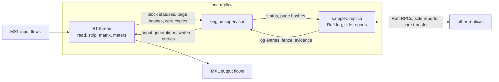

# samplez architecture

How samplez is built: its crates, the engine's threads and the paths
between them, replicated mode, and how a product plugs in. What each
feature does and how it is configured is in [USAGE.md](USAGE.md).

## Crates

| Crate | |
| --- | --- |
| `samplez` | the engine: configuration, supervisor, RT loop, block statuses and hold rings, state transfer, and `samplez-hop` |
| `samplez-dsp` | planar buffers, gain ramps, the mixing matrix with duck masks and depths, the channel strip, the output limiter, the duck detector, delay lines, the tone generator, meters, true peak and loudness, history rings |
| `samplez-mxl` | MXL flow input and output on libmxl v1.1.0, loaded with `mxl::load_api` |
| `samplez-replica` | a product's state replicated over openraft: the log and snapshots on the replica's volume, the applied command ids, the bridge to a replicated engine, clock checks, resync and rollouts |
| `samplez-service` | the non-RT service layer of products: listeners, TLS, auth, ops endpoints, the OpenAPI document and WebSocket fan-out |
| `samplez-nmos` | NMOS for products: the IS-04 v1.3 Node API and the IS-05 v1.2 Connection API with MXL senders and receivers per BCP-007-03 |

`samplez` does not depend on `samplez-replica`; the replica drives an
engine through `samplez_replica::bridge::EngineAudio`. `samplez-nmos`
links no libmxl.
Everything builds for x86_64 Linux only.

## Threads and data flow

Without replication (`Engine::start`, which `samplez-hop` uses) there is
no `samplez-replica`: the engine stamps its own entries.

## The engine

### The RT thread

The RT thread computes one block per wake: it reads each input's block,
runs the delay lines, strips, duck detectors and the matrix, the output
strips, delay lines and limiters, writes each output, and hands meter
records, block statuses and page hashes back to the supervisor through
rings. It does not allocate and takes no lock once its loop runs
([BUILDING.md](BUILDING.md) has the gates that enforce it). The only calls
that block by design are `mxlSleepUntil` and the `FUTEX_WAKE` of the
output commit.

The RT thread waits for a block's input by reading the readers' heads,
which are in the flows' shared memory, and sleeping until the slowest can
have reached the block at the sample rate, at least 100 us and at most
half a block period or the block's deadline. It does not use libmxl's
sync-group wait: once that wait times out, libmxl checks the flow's
validity with a `stat()` of its data file, which on a file system that
waits for a missing name blocks once the flow is deleted. libmxl's read
runs its validity check only when the head moves back between the head
read and the read, which reports the block `TooEarly`; the RT thread runs
no other validity check, and the supervisor's poll reader checks a pruned
input's flow once a lookup found it.

Every output value is a function of the sample index, the inputs and the
entries applied at their indices: ramps, fades, the tone, the duck grid
and the delay rings are computed from the index, so the output does not
depend on the block size, the SIMD path or the blocks a ramp spans.

### The supervisor

The supervisor is the one thread making instance-mutating libmxl calls.
It drains meter records and status changes, polls pruned inputs, creates
and releases output writers, and builds input generations.

An input generation is the set of readers the RT thread reads from.
`InputUp`, `Route` and `Detach` need a new one: a slot that keeps its
flow, and a re-route's outgoing flow, take the reader the live generation
holds, and the engine opens the readers of the other flows from the
entry's append, each on a libmxl instance of its own (a domain watcher
thread and three descriptors, released with the reader; four per input
domain created ahead by the openers). Four opener threads look each flow
up first, waiting 20 ms at most, so a lookup that waits fails that open
and frees its opener; a re-route whose flow a dropped entry's open still
opens adopts that open. The supervisor builds the generation once they
are open, one at a time, and swaps it in at the entry's index.

Once a supervisor tick and 2 ms are all that is left before the
generation would reach the RT thread past that index, it waits for no
reader: one whose open is not done is left out, the generation is swapped
in on time without it, and the slot is silent and reported unreadable on
that engine alone until the reader is open, then added back through the
next build. A re-route that adopted a dropped entry's open whose lookup
outlives the 20 ms gate comes back through the poll's recovery within 2 s.
A generation handed over with less than those 2 ms left is counted in
`generation_past_margin` (`Engine::counters`). While an entry not handed
over falls due within a poll period (100 ms) and a tick, the supervisor
neither polls pruned inputs nor creates output writers, so none of their
libmxl calls can stall it past the deadline. A released output writer is
dropped on the supervisor when the RT thread hands it back: its flow must
be gone before the output's flow is created anew.

The status reports the 99.99th percentile of the latest 256 build times,
each the longest of its new readers' opens, instance creation included,
and its assembly; a build that opens nothing or left a slot out is not
counted, and a late reader's open counts up to 100 ms. buildLead, how far
ahead such entries are stamped, is that percentile, at least 30 ms (a
libmxl reader open was measured at up to 23 ms), plus a supervisor tick
and 2 ms on top of the engine's lead. `Engine::progress` reports buildLead
and the build time.

libmxl opens an input flow only once a lookup of the flow's directory, on
a thread of its own, found it, so a domain whose lookup of a missing name
waits for the name holds up that thread and not the supervisor. A replay
and a build for a product state wait 20 ms at most for their lookups and
leave out, or fail on, a flow not found by then. An output flow whose
directory is not found is created without libmxl's check for a live
writer, which looks the name up; a flow that is there after all is opened
and reported raced. A pruned input's poll reader opens a flow on its
domain's one poll open thread, so a slow libmxl open holds up no poll;
the flow polls as not readable until it is open. The supervisor reads the
head of a pruned input at its polls and of an attached one from the RT
thread's statistics, once a second.

### Entries and batches

A replicated log entry may carry any number of engine entries
(`append_batch`). They are folded off the RT thread: per matrix
coefficient, strip parameter and output the last value; per output its
last limiter parameters and delay; per input slot its last delay and tone
parameters, whether it is re-routed or detached (the last `Route` or
`Detach` counting), goes down and comes up (an `InputUp` after an
`InputDown` fading in from silence); per meter its last `LoudnessRun` and
each reset once; duck settings per group and kind of setting, per depth
and per mask. The batch is shared by reference and never changed once
folded. It takes one of the 64 places the RT thread holds for entries
before their index and applies whole at its index, its gains first; one
generation covers every slot it raises or re-routes, and a late one counts
once in `command_late`.

A log entry raising or re-routing inputs of more than one domain, or with
an entry refused alone, is refused whole (`append_batch`, `admits`). An
entry with no engine entries appends nothing. A replicated engine refuses
no committed entry for room: up to 256 committed entries
(`engine::WAITING`) wait for room in its entry ring; past that it drops
them and its core (`log_overflows`), and the replica is rebuilt or
resynced. The RT thread hands its spent batches to the supervisor to be
freed; one it cannot hand off is leaked and counted (`batches_leaked`).

## Replicated mode

`samplez-replica` keeps a product's state in a Raft log over openraft.
Every replica applies the log, derives the engine entries of each log
entry from the product's state ([Derivation](#targets-and-derivation)),
and hands them to its engine (`Engine::start_replicated`) at the same
sample index. Each replica hashes the pages it writes; the hashes are
compared across the set, and a replica whose output differs is marked
diverged and resynced from a donor's engine core.

### Contact

Besides Raft, every replica sends side reports to every voter each
`report_period`: its block statuses, page records, input readability,
versions and key, configuration hash, clock and slack. The contact loop
holds the `Contact` lock while it handles them. Reports, openraft's RPCs
and the other peer requests travel over HTTP/1.1 on the peer listener's
mutual TLS, both ends with `TCP_NODELAY`, kept open between requests
(`net::Pool`, at most four idle per peer). A request that runs out of
time counts as missed, but its exchange goes on and gives the connection
back once answered, closing it only `net::DIAL_WITHIN` (1 s) past the
deadline. A request finding no idle connection waits for one given back
or dialed and never dials within its own time: a dial (name resolution,
TCP and TLS) runs on its own within `DIAL_WITHIN`, one at a time per peer
and none while a timed-out exchange is still to give a connection back.
A peer's address is resolved on its first dial and again only after a
dial to what it resolved to fails.

A report carries each page record, of the sender's own pages and of those
of every voter it relays, until the addressee echoes a report carrying
it; a voter keeps every record it takes, so a record is not sent again
unless it changes. An addressee not heard within `contactWindowMs`, one
whose report echoes nothing or none of the sender's last 1024, and one
whose sequence numbers jump by more than 2^20, as a restarted process's
do, is sent every record again. A voter whose reports the addressee did
not take within `contactWindowMs`, or holds silent, has its newest
records relayed to it whole.

### Stamping and the apply lead

The leader stamps each entry with the index it applies at: the lead
ahead, kept on the slack every counted audio replica reports at its
apply-hand, up to `max_apply_lead`. An entry not applied by its apply
deadline (`T(at_index)` minus `w` and twice `clock_guard`) is unresolved
and its record never handed, however early reports made its commit known;
the log decides it. A replica that still applies past the deadline at the
cap holds those entries unresolved, and the leader names it
(`apply_lead_raised_by`).

Slack of an entry the log holds from an earlier term does not count: an
earlier leader stamped it and its commit waited for the election. A new
term also voids the slack the lead was kept on and clears the cap flag;
the lead itself is kept. Until it next rises the lead may start falling
after one clean minute instead of ten, at a block a minute. The leader
keeps the lead each entry applied on a counted audio replica needed, over
the current minute and the last, and stamps every decision on an
unresolved entry and every `Baseline` with it, and at the cap every
command too, up to 64 ms past `max_apply_lead`, in whole blocks and under
one second past the stamp. One slow replica therefore raises the latency
of every command by up to 64 ms while the lead is capped. The lead does
not fall while entries need more than it; after two minutes without
entries the need is forgotten. A command appended while a decision is
ahead takes effect no earlier than the decision.

A client command that would re-route an input (`Product::reroutes`) is
ordered alone on the generation path, stamped the lead and the longest
build time a counted replica reports, at most `AHEAD_MAX` (one second)
past its stamp. A build that would need more leaves the entry applied on
time and the slots it raises or re-routes silent until the generation is
swapped in (`generation_late`).

### Commit and withdrawal

`Engine::start_replicated` takes the set's voter count. With one voter
the engine commits every block at once. With more, each block of each
output gets a status word (`fenced`, `held`, `committed`, `withheld`),
moved by compare-and-swap and sent as `StatusChange`s. The replicated
state publishes F (`set_fence`), the ranks (`set_ranks`: one up to a
block, another from it on, and the rank of a withdrawn replica's fills)
and evidence (`commit_through`, for a whole block or up to a sample index
inside it), and withholds blocks (`withhold`).

An output commits only from its commit start (`commit_from`, dropped
again before it takes by `cancel_commit_start`), the first page boundary
of 1024 samples in a block it computes, and stops at `stop_at`; such a
block is split and its status covers one range. `standing` reads whether
an output commits, from which sample, or since which block it does not. A
healthy block with F past it and nothing held before it commits at once;
any other waits in the output's hold ring of `D + w + 2B` samples and is
committed later in one write, or withheld and never written. A withheld
block, an overrun skip or a full ring withdraws the replica on every
output: it then commits only on evidence, from the next page boundary.
Each block carries a digest of what degraded it: inputs whose read
failed, entries applied without their generation, and unresolved entries
(`unresolved`). A writer commits a range of up to the ring's length, and
an output whose flow ring is not twice that is not realised.

### Page hashes

Each page of each realised output the engine computes whole, in every
commit mode, is hashed (XXH3-64 over its samples' f32 bit patterns,
channels interleaved per index) and sent as a `PageHash` once every block
overlapping it is final, with the fingerprint of the entries applied in
it and whether the page was committed whole. Page hashes are compared, by
Resume and by the leader's page verdicts, only between replicas that
report equal keys: a replica of another key than the baseline's reaches
`version_mismatch` rather than `diverged`. A page that replicas of two
keys both committed whole is an output carrying both: the leader raises
`replica_disagreement` and diverges those whose key is not the
baseline's.

### Input liveness

In replicated mode the audio voters decide an input's liveness by
majority. Each reports the input slots its engine reads
(`InputStatus::readable`: attached, or down in the log with its head
advancing for a second) and those it does not; a detached slot, one
waiting for its generation, a replica in `starting` or resyncing, and a
binary that reports neither have no say. The leader takes an input down
once more than half of the audio voters of every configuration of the
membership, the witness left out, report it unreadable, and up once more
than half report it readable; a voter whose latest report is older than
`contactWindowMs` plus `holdMs` counts for neither. Of three audio voters
two must agree, of two and the witness both; a set with one audio voter
decides on its engine alone, and nothing while it is in `starting`.

A change the majority keeps for `Timing::prune_after_blocks` blocks is
returned once by `Replica::input_liveness` on the leader, as
`Report::InputPruned` or `Report::InputReadable`, again after a second
while the log does not show it, and never while the log already holds
that state; the product appends it as an `InputDown` or `InputUp`. So an
input late on one node takes the input down nowhere: that replica reads
silence, its pages differ and the page verdict diverges it. A majority
flapping faster than `pruneAfterBlocks` appends nothing.

### Clock verification

Every audio replica starts clock-unverified, which drops its engine's core
until it verifies. A replica whose kernel TAI offset is not the set's, or
whose clock is beyond `clock_guard` of a majority, holds no engine core:
it reads no input and prunes none. A detected clock step fences blocks
([Clock](USAGE.md#clock)).

### Resync

For a resync, `Engine::copy_core` has the RT thread copy the engine's core
after the next block k0 into a buffer allocated off it: the matrix with
its ramps, delayed fades, duck masks, depths and mask crossfades; the
duck detectors with their keys, filter, hold and envelope state; the
pending entries and those applied in the page in progress; each input's
log state and fades; each strip with its filter and dynamics state; each
limiter with its rings and released gain; each delay line's taps and the
history they reach; the entries waiting for a generation and the pending
generation's entry id; the meters the log holds paused; and the
unresolved entries. Meters, hold rings, statuses and readers stay with
the replica.

History rings (`samplez_dsp::History`) hold a delay plus `historySlackMs`
as relaxed atomic bit patterns; the RT thread publishes the block it
starts before it stores any history sample, and a copy is kept only while
the RT thread has not started the last block of the slack after k0. A
delay line reads nothing older than its taps reached without a break, so
that is all the history a resync copies, off the RT thread, after the
core; a replica reads a donor's answer of up to
`samplez_replica::peer::max_response` of it. With more than one voter
every input flow offers `resyncBudgetMs`
of history beyond the read window; a shorter one is refused with an error
naming the `history_duration` it needs.

`Engine::replay` builds a replay clone from a donor's core: the engine's
block computation off the RT thread, its readers on a new instance per
input domain reading the blocks after k0 from the flows' history, its
entries after the core's last log id taken from the caller, and every
page it computes whole hashed. A core with a generation-needing entry in
flight (`InputUp`, `Route`, `Detach`, a pending generation or a
crossfade) is not replayed, nor one whose detached inputs are not the
engine's. `Replay::run_to` stops at the newest block due, and
`Replay::silenced` names the blocks computed with an input silenced. The
status reports the replay speed, blocks per block period, measured at
start-up on silence. A resync's joiner replays the records of the entries
applied after the donor core's last log id; one it no longer holds fails
the attempt, which is retried on a newer core.

`Engine::hand_over` waits for the RT thread to compute a block, runs the
clone up to it and passes its state to the RT thread by owned pointer
before the next wake. The RT thread installs it before the next block if
it has not started that block, still holds the generation the core names
and took no entry off its pending list that the core does not know, and
computes on from it. A hand-over writes the replay's history into the RT
thread's other set of rings, which the RT thread takes only when it
installs the core, so a refused hand-over leaves the set it reads as it
was; each later attempt writes only the blocks computed since. A state
refused for a passed block or a generation is tried again; one missing an
entry returns `ReplayError::Missed`. Refusals are counted per cause.

`CoreCopy::encode` gives a copy as another replica takes it, JSON with
the engine version. `CoreCopy::decode` refuses a core of another version
or one holding a value no engine holds: an index beyond 2^62, a gain or
strip parameter out of range, a ramp past its length, a matrix beyond
`MAX_COEFFICIENTS`, a strip, limiter or detector their `is_valid` refuses,
a filter target or ramp outside its parameters', a duck key without its
slot or the reverse, a mask, depth or mask crossfade out of range, or a
duck setting no group takes. `Engine::replay` refuses one of another
shape, with strips or duck keys of other legs or ramp length, or with an
entry outside the engine.

A diverged replica is rebuilt from product state instead of resynced, on
the attempts' backoff:

- when its input reads another flow than its applied state names, as one
  does after holding a `Route` unresolved that stands, once the mismatch
  outlasts `max_apply_lead` and 64 ms
  (`samplez_replica_resync_rebuilt_for_flows_total`); a copy carries no
  flows. A page that still differs then resyncs;
- when its committing peers all report other keys
  (`samplez_replica_resync_rebuilt_for_key_total`);
- when its outputs are all disabled, or it has none
  (`samplez_replica_resync_rebuilt_writing_nothing_total`): nothing
  commits, so no donor comes. Once an output is enabled again, the leader
  names a replica that commits and each other one whose page differs
  resyncs from it. With nothing written every replica reports an entry's
  block withheld, so such a replica also diverges when the log restamps
  an entry it applied in time.

A core that does not decode, or that `Engine::replay` refuses as
`ReplayError::Invalid`, is refused for good
(`resync::Failed::Refused`, `samplez_replica_resync_refused_total`) and
the replica is rebuilt.

### Rebuild from product state

An unverified clock, a snapshot install, a purge-point verdict, a log
overflow or a lag beyond the horizon drops the engine's core
(`Engine::drop_core`): the RT thread keeps its writers, flows, hold rings
and statuses, computes no block and withholds each one, cause `NoCore`,
with the replica withdrawn. Entries needing no generation whose index
passes meanwhile are taken off the pending list; strip, limiter, delay
and tone entries apply to the strips, limiters, delay lines and tone
generators the RT thread keeps, other entries do not, and the core
installed next must know them. A batch holding an `InputUp` or `Route`
stays pending whole.

The core is rebuilt from the applied state
(`StateMachine::product_state`): the product's targets, each slot up as
its latest `InputDown` or `InputUp` says, no pending entry and the applied
log index as its last id. `Engine::install_product` builds it off the RT
thread and installs it through the same block-boundary hand-over as a
replay, at the first block at or after the floor of the applied log;
every record up to that index takes effect at or before the floor, so
later records apply on top in order. Under continuous writes the floor
lies up to the stamping lead and a generation's build ahead, and the
rebuild waits that long and 100 ms more. A state holding a value no
entry could set is refused before anything changes. A product without
targets gives an empty state, which an engine refuses: its replicas stay
in `starting`.

The install sets every gain at its target from its first sample, and an
input that is up and attached continues with no fade-in, except for what
the state names in flight (`ProductState::in_flight`, `samplez::InFlight`):
input fade-ins and crossfades, delayed fades (`ProductState::fading`),
duck depth ramps and mask crossfades, and tone generator ramps
(`ProductState::tone_ramps`), each continued at its value for the install
index as a peer that ran through computes it. The supervisor hands over
generations reading the state's flows before the core, a slot on another
flow moving to it with no crossfade. Strip, limiter and delay parameters
are set from the install's index, each keeping its own state.

A rebuilt replica therefore matches a peer that ran through from its first
block as far as the gains and inputs go, with these exceptions, which
follow the samples an engine computed and only a resync copies:

- duck detectors start cold: key filters at rest, no hold, the envelope
  at 0 or, for a group on or held, at full depth. A mask crossfade
  continues bit for bit only where the detectors were steady over it and
  the depth held its value before the ramp; over a depth changed more than
  once within it, it differs until both end. A depth changed again while
  its earlier ramp ran, after the second last end of a duck gain interval
  before the install index, gets other gains there than its peers held;
- the filter and envelope state of input and output strips, the limiters'
  rings and gain, and the delay lines' history and taps (a crossfade in
  flight) start cold in a new process.

Where they differ the output does: the first page the rebuilt replica
computes whole that differs from one a committing replica committed
diverges it, by Resume's comparison or the leader's page verdict, and it
resyncs from a donor's core, which carries that state. A keyed group whose
envelope never reaches 0 or full depth so costs one page and a resync.

A replica catching up after a restart or a snapshot install, whose log
has taken no entry past the commit index the first voter report named
before that entry's deadline, holds none of those it took past the
deadline unresolved while it is in `starting`, `withdrawn` or `diverged`
with no output committing: its engine is rebuilt from the state applied
past them, one rebuild at a time (`late_rebuilds` in the contact
metrics). A replica with no outputs or one committing, and one taking
entries late after it caught up, holds them unresolved. Those it took late
while catching up and applied while it committed are rebuilt past once it
commits nothing again, and so are the entries a rebuild on a replica
committing nothing finds held unresolved: the log decides only an entry
the baseline held unresolved as it committed its block, or that every
live replica withheld. A replica about to commit, and one named in a key
hand-over, holds them again until it commits. One AppendEntries carries
up to `MAX_APPEND_BYTES` of commands, so a follower whose fsync is slower
than the gap between entries takes every entry written meanwhile with one
fsync.

### Locks

The replica's `Contact` lock and the `Store`'s log lock, applied-state
lock and state gate record their holders; no other lock is watched
(`lock_watch`). A watchdog thread, started with the first replica in a
process, a test's included, checks them every second, and when one
has been held for more than 10 s it writes the lock's name, each holder's
thread, how long it has held it and the call site where it took it, and
every thread waiting for it with its call site, to stderr, and aborts the
process. A lock-order deadlock thus ends the process at once with a
report. The locks are not on the RT thread's code paths.

No path holds either lock across disk or network I/O or a wait. The
store's file writes, fsyncs, snapshot writes and log compaction run on the
blocking pool outside its lock, and the contact's engine rebuild, core
copy and resync run outside the contact lock. `Store::open` replays the
whole log before the store's lock exists, so a restart over a long log is
not watched. What runs under the locks is in-memory work bounded by the
state or batch size.

The contact loop holds `Contact` while it reads the store, so no code may
hold a store lock and wait for `Contact`. `Store::with_state` and
`Store::view` take the state gate for reading, and every apply and
snapshot install takes it for writing, so while a product's closure runs
no apply waits for the state and the contact loop's reads go on: the
closure may call `Replica` methods and read the store again. Closures run
side by side; an apply waits for those running when it arrives. A closure
therefore must not wait for an entry to be applied, nor for another
thread reading the store. `Product` methods run under the store's locks,
as do the closures of `pending`, `records` and `entries_after`; there a
call into the `Replica` or the `Store` panics, naming the lock, rather
than deadlock.

A client snapshot builds the product's whole text and holds the gate,
and with it every apply, while the text is built. `Product::text_later`
lets a product hand out a closure that builds the text after the gate is
released, over state fixed at that call.

## How a product plugs in

A product is the state a replica set agrees on: it implements
`samplez_replica::Product`, and a replica's store builds its empty product
with the `Factory` it is given, at open and for every snapshot it
installs, so the product keeps the replica's configuration.

### The Product trait

| Item | Role |
| --- | --- |
| `apply`, `expire`, `forget` | apply a command, end what a session held under its lease, drop what is kept for a session past its lifetime |
| `delta`, `text`, `text_later` | what clients read: one delta per entry, the whole state |
| `save`, `load` | the state as snapshots carry it |
| `config_hash` | the configuration that changes how a command applies or a state loads ([Configuration](REPLICAS.md#configuration)) |
| `DRIVES_ENGINE`, `targets` | whether the product drives an engine, and its absolute engine targets |
| `reroutes`, `route_slot` | the input slots a command would re-route, ordered alone on the generation path |
| `DERIVATION_VERSION` | the version of how the product derives state and engine entries from the log |

None of the methods may call back into the `Replica` or its `Store`.
`Product` is `Sync` because the contact loop reads the state beside a
`with_state` closure. A product that drives an engine owns every input's
flow: `Replica::append` refuses a `Route` or `MasterEnable` for it, and a
client command asking for an index beyond the earliest is refused.

### Targets and derivation

`samplez::Targets` holds every gain with its fade (`Targets::fading`),
flow, strip and output strip parameter, limiter parameter, delay, tone
parameter, duck group setting, duck mask, output enabled state, pre-strip
meter switch and meter running state as values. `Targets::diff` gives the
entries that move an engine from one set of targets to another, comparing
every value by bit pattern, so a gain that keeps its bits but whose fade
differs gets an entry too; `Targets::assert` gives the entries that set
all of them.

The state machine derives each log entry's engine entries as it applies,
from the state after it: the diff of the targets for a command or a lease
expiry that changed the product, every target and the routes of the entry
it names for a restamp of one that derived some, and an input's state for
an `InputDown` or `InputUp`, for any product. Each record applies at the
entry's index raised to the floor, the highest index of any entry before
it, so the engine applies them in log order and each diff applies to the
targets it was computed against. An index further than `AHEAD_MAX` past
the entry's stamp counts as the stamp, and a lease expiry from an older
leader, which stamps none, takes effect 3072 samples (64 ms) past its
stamp. A target gain `valid_gain` refuses is read as 0.0, in the records
and in the product state alike. `EngineAudio` hands an index off a block
start at the next one, and contact hands an entry's record to the engine
as the entry applies. A restamp, or a void the leader stamped, of an
entry that derived records re-asserts every target at its own index, so
it undoes no later entry. Records are kept in memory for a second past
their index; the floor and which decidable entries derived records, with
the inputs they re-routed, are in snapshots.

The replica tracks the ramps the derived entries leave the engine on: the
ramp of each gain entry (`Limits::ramp_samples`) and fade as the engine
joins it, input fade-ins and crossfades, duck depth ramps and mask
crossfades, and the tone generators' ramps (`samplez_dsp::ToneRamps`), at
the block-aligned index the bridge applies each at, and carries them in
its product state and its snapshots, pruned once they end below the
floor. A snapshot without them loads with none.

A product resets a meter's loudness measurement by moving its reset epoch
forward (`Targets::loudness_resets`, one `u32` per meter, the outputs then
the configured meters). The epoch counts forward only and wraps: one lies
ahead of another when it is 1 to `i32::MAX` past it. A diff gives one
`ResetLoudness` per meter whose epoch moved forward; an assert gives none,
so re-asserting the targets never resets a meter. A restamp gives the
resets again in its own record and the entry's own record never applies,
so a reset applies exactly once, where the log decided it; a void drops
them. A rebuild or a snapshot load gives no reset either.

`EngineAudio` installs product state and filters records as an engine
would take them. A value its engine refuses is replaced, so a replica
holding a value before the refused one and one rebuilt without it hold
the same: a finite value out of range moves to the nearest one in range
(`StripParam::clamped`, `LimiterParams::clamped`, `ToneParams::clamped`,
`DuckSetting::clamped`), so a trim of -30 dB sounds as -20 dB; a value
that is not finite, or keys the engine cannot take, give the neutral
setting (`StripParam::neutral`, `DuckSetting::neutral`,
`LimiterParams::OFF`, `ToneParams::DEFAULT`), each over the strip's ramp.
A refused mask is 0, a refused delay none. Other refused entries, and the
`InputUp`s and `Route`s of all input domains but the lowest slot's, are
left out before the record is appended. The engine's configuration
decides that alike on every replica of a key; each one replaced or left
out is counted in `entries_filtered` and logged as the product's fault.

### Versions and the compatibility key

A replica's compatibility key (`rollout::key`) is a hash of three versions
(`rollout::Versions`) and the output config:

- `samplez::COMPUTE_VERSION` (3): what the engine computes from the same
  log and inputs, samples and meters, dependency and toolchain changes
  included, and what a core copy holds or how it encodes. A core copy is
  taken only at an equal `COMPUTE_VERSION`. `samplez-dsp` pins `libm` to
  one exact version, since another can compute other bits, and a product
  pins it likewise.
- `samplez_replica::PROTOCOL` (7): the log's wire format and the
  library's replicated semantics (the state machine, the `Entry`
  variants, the `Targets` fields, restamp and void handling, the block
  digests peers judge pages by), and how page hashes or entry
  fingerprints are computed. It is pinned by
  `entry::tests::the_protocol_is_pinned`.
- `Product::DERIVATION_VERSION`: when the same log would apply to another
  state, derive other entries or save another state.

Each replica reports its versions beside its key, and a `Baseline`
carries the named replica's. A `Baseline` named before its replica
reported a key carries none; the leader and every replica then take those
the named replica reports while it commits, and a replica keeps the key
it took for that `Baseline` while the named replica stops committing for
a moment. A replica named by a `Baseline` without a key commits under it
only under the key it stands for: the committing replicas' while none of
them reports its own, else its own when it first saw that `Baseline`.
`Replica::rollout` called
before `Replica::contact` puts the key in the replica's first report. The
leader names no replica whose report carries no key while another reports
one. How rollouts and rollbacks run is in [Rollouts](REPLICAS.md#rollouts).

Two goldens pin what `COMPUTE_VERSION` stands for: `tests/golden.rs` the
bits the DSP kernels compute on a fixed signal, and `src/engine/golden.rs`
the bits the RT loop computes offline from fixed scenes, logs and inputs:
samples, every meter value, page hashes and the encoded core copy. Their
hashes sit in tables with a row per `COMPUTE_VERSION`, so a change that
moves any of them fails until the version is bumped and a row added. The
pages' entry fingerprints are a single pinned value, replaced with the
`PROTOCOL` bump that changes them.
